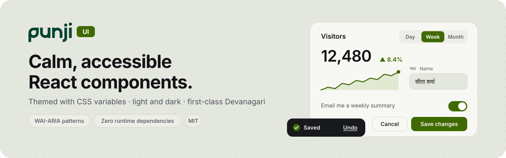

<a href="https://design.punji.app">
  <picture>
    <source media="(prefers-color-scheme: dark)" srcset=".github/assets/punji-ui-banner-dark.svg">
    
  </picture>
</a>

> [!NOTE]
> `@punji/ui` is at 0.4.0 on npm, published from CI with provenance. It is pre-1.0: a minor version can change APIs and styles, so pin an exact version and read the [changelog](./CHANGELOG.md) before you upgrade. Each page of the docs carries a [stability level](#stability-levels); several newer modules are beta or experimental.

<p align="center">
  <a href="https://github.com/20was/punji-ui/actions/workflows/ci.yml"></a>
  <a href="https://scorecard.dev/viewer/?uri=github.com/20was/punji-ui"></a>
  <a href="https://www.npmjs.com/package/@punji/ui"></a>
  <a href="./LICENSE"></a>
</p>

<p align="center">
  <a href="https://design.punji.app">Documentation</a> ·
  <a href="./ROADMAP.md">Roadmap</a> ·
  <a href="./CONTRIBUTING.md">Contributing</a> ·
  <a href="./SECURITY.md">Security</a>
</p>

# Punji UI

**Finance UI for React 19: exact `bigint` money, stock-market tables, ledgers, charts and a Nepal-first locale layer that works for any currency.**

Built for the screens where a wrong digit costs someone money:

- stock market and trading apps (quote boards, movers, watchlists, heatmaps, order book depth, candlestick and fundamentals charts)
- portfolio and wealth trackers (positions, cost basis, P&L, allocation, performance)
- accounting and bookkeeping tools (ledgers, journals, trial balance, statements, invoices)
- banking and fintech dashboards (money display and input, statements, status, export)

## Contents

[Install](#install) · [Quick start](#quick-start) · [What's inside](#whats-inside) · [Subpath imports and bundle size](#subpath-imports-and-bundle-size) · [Stability levels](#stability-levels) · [Theming](#theming) · [Links and routers](#links-and-routers) · [Charts](#charts) · [Optional integrations](#optional-integrations) · [Accessibility](#accessibility) · [Docs, contributing, licence](#documentation)

## Install

```sh
npm install @punji/ui
```

Requirements:

- React 19 and React DOM 19 (`^19.0.0`) are peer dependencies. React 18 is not supported.
- Node 22.12 or later for tooling and server rendering.
- ESM only, with bundled TypeScript declarations (written against strict mode).
- One runtime dependency: a pinned, MIT-licensed Bikram Sambat converter, imported only by `@punji/ui/nepal/calendar`. CI fails on any other. See [DEPENDENCY-AUDIT.md](DEPENDENCY-AUDIT.md).
- Optional peer dependencies, installed only if you use the matching adapter: `@tanstack/react-table`, `ag-grid-community`, `@mui/x-data-grid`, `lightweight-charts`, `echarts` (see [Optional integrations](#optional-integrations)). Nothing in the root export or the core bundle loads them.

## Quick start

Import the CSS once at your app's root, then use the components. Prices are `bigint` minor units (paisa, cents), so `51230n` is Rs 512.30:

```tsx
import '@punji/ui/styles.css';
import { MoneyDisplay, PriceChange, StockTable, type Quote } from '@punji/ui';

const quotes: Quote[] = [
  { symbol: 'NABIL', ltp: 51230n, previousClose: 50500n, volume: 12400, turnover: 63_525_200n },
  { symbol: 'NTC', ltp: 84000n, previousClose: 85000n, volume: 3100, turnover: 26_040_000n },
];

export function Board() {
  return (
    <>
      <p>
        Portfolio value <MoneyDisplay value={123456789n} currency="NPR" locale="en-IN" />{' '}
        <PriceChange current={51230n} previous={50500n} currency="NPR" />
      </p>
      <StockTable caption="NEPSE quotes · NPR" quotes={quotes} />
    </>
  );
}
```

That renders `NPR 12,34,567.89`, a signed change with an arrow and a spoken label (not colour alone), and a sortable, accessible quote table. The data above is invented. For another currency, change `currency` and `locale` (for example `"USD"` and `"en-US"`).

Nothing here fetches data. You pass quotes, rows and amounts in as props; for live feeds, pass new props from your own socket or query. Accounting components are display and arithmetic helpers, not an accounting system: your server must validate every amount again ([ACCOUNTING.md](docs/ACCOUNTING.md)).

## What's inside

The package has about 270 entries in its `exports` map: the root plus one subpath per module (`@punji/ui/<name>`) and one stylesheet per module (`@punji/ui/css/<name>.css`). The full list is the `exports` map in [package.json](package.json). The documentation site has 258 pages: 189 components, 24 utilities, 15 guides, 12 full-app dashboards, 13 patterns you can copy in, and the foundations and hooks pages.

| Domain | Key exports | Guide |
| --- | --- | --- |
| Money and Nepal | `formatMoney`, `parseMoney`, `MoneyDisplay`, `PriceChange`, `CurrencyInput`, `Money`, `formatNPR`, `gregorianToBS`, `nepalFiscalYear`, `FxRateDisplay`, `convertMoney`, `PrivateAmount` | [FINANCIAL.md](docs/FINANCIAL.md), [GLOBAL-MONEY.md](docs/GLOBAL-MONEY.md) |
| Calculations | `computePosition` (FIFO or weighted average), `valuePosition`, `breakEvenPrice`, `taxOnGain`, `allocation`, `percentageChange`, `cagr`, `divideRounded` | [FINANCIAL.md](docs/FINANCIAL.md#financial-calculations) |
| Market | `StockTable`, `MarketMovers`, `MarketIndices`, `MarketStatus`, `InstrumentHeader`, `Watchlist`, `MarketHeatmap`, `MarketBreadth`, `RatingScale`, price alerts (`AlertRow`, `alertDistance`), `DataFreshness`, `getMarketSession` | [MARKET.md](docs/MARKET.md) |
| Screener | `FilterBar`, `FilterMenu`, `RangeEditor`, `FilterPopover`, `PresetTile`, `filtersToSearchParams`, `useUrlFilters` | docs site |
| Accounting | `LedgerTable`, `JournalEntryView`, `TrialBalance`, `StatementTable`, `DebitCredit`, `PaymentStatus`, `isBalanced`, `runningBalance`, `ledgerToCsv` | [ACCOUNTING.md](docs/ACCOUNTING.md) |
| Banking and payments | `BankAccountCard`, `TransactionList`, `PaymentReceipt`, `BeneficiarySelector`, `maskAccountNumber`, `isValidIban`, `transactionsToCsv` | [BANKING.md](docs/BANKING.md), [PAYMENTS.md](docs/PAYMENTS.md) |
| Lending, deposits, KYC | `LoanCalculator`, `AmortisationTable`, `DepositCalculator`, `NepalAddressPicker`, `OnboardingWizard`, `calculateEmi`, `xirr`, `projectSip`, `validatePan` | [LENDING.md](docs/LENDING.md) |
| Trust and safety | `TransferReview`, `ConfirmAmount`, `PayeeVerification`, `HoldToConfirm`, `SessionTimeoutWarning`, `ScamWarning`, `SecureField` | [TRUST.md](docs/TRUST.md) |
| Tables | `DataTable`, `FinancialTable`, `ScrollTable`, `VirtualFinancialTable` (10k+ rows, pinned and resizable columns, multi-sort), `TableExport`, print stylesheet | [TABLES.md](docs/TABLES.md), [PERFORMANCE.md](docs/PERFORMANCE.md) |
| Charts | `CandlestickChart`, `PerformanceChart`, `DepthChart`, `Sparkline`, `ColumnChart`, `WaterfallChart`, `SankeyChart`, `ChartA11yShell`, and more (see [Charts](#charts)) | [CHARTS.md](docs/CHARTS.md) |
| App shell and navigation | `AppShell`, `BottomTabBar`, `Breadcrumb`, `MenuButton`, `NotificationBell`, `SkipLink`, `RouteAnnouncer`, `ThemeProvider`, `LinkProvider` | docs site |
| Articles and guides | `Callout`, `KeyFacts`, `Timeline`, `TableOfContents`, `Faq`, `faqJsonLd` | docs site |
| General UI | `Button`, `Card`, `Tabs`, `Select`, `Dialog`, `Drawer`, `Sheet`, `Accordion`, `CommandPalette`, `Calendar`, `DatePicker`, fields, states and layout | [COMPONENTS.md](docs/COMPONENTS.md), [CALENDAR.md](docs/CALENDAR.md), [SELECT.md](docs/SELECT.md) |
| Hooks and export | `useDebounce`, `useControllableState`, `usePagination`, `useTableSelection`, `useMediaQuery`, `toCsv` (formula-injection neutralised) | [HOOKS.md](docs/HOOKS.md), [EXPORT.md](docs/EXPORT.md) |

Also documented on the site: tax, share issues, wallets, trading, reconciliation and portfolio modules ([TAX.md](docs/TAX.md), [SHARE-ISSUES.md](docs/SHARE-ISSUES.md), [WALLETS.md](docs/WALLETS.md), [TRADING.md](docs/TRADING.md), [PORTFOLIO.md](docs/PORTFOLIO.md)).

### Why it exists

- **Exact money.** Amounts are `bigint` minor units, never floats. Rounding is always an explicit mode you pass (`half-even`, `half-up`, and others), and the calculation layer is property-tested (cost is conserved, allocation shares sum to exactly 100). Charts that show amounts take bigint or decimal strings too.
- **Nepal-first, currency-generic.** NPR with lakh/crore grouping, Devanagari digits and Nepali labels, the Bikram Sambat calendar and fiscal years, and NEPSE-style market sessions and price limits. All of it is a preset: USD, EUR, JPY, KWD and any other ISO currency work through configuration, with the exponent taken from `Intl`.
- **Accessible by default.** See [Accessibility](#accessibility).
- **SSR and RSC friendly.** Components that use state or events carry `'use client'`; the pure modules (`money`, `calculations`, `export`, `ledger`, `nepal/*`) have no React or browser globals, enforced in lint. The release check server-renders the packed tarball.
- **Tested visually.** Screenshots of every fixture in light and dark at phone and desktop widths are compared in the same Playwright Docker image CI uses ([VISUAL-TESTING.md](docs/VISUAL-TESTING.md)).

### Works with

React 19 or later. The release check installs the packed tarball into a fresh project, type-checks it with strict TypeScript, renders it on the server and builds it with Vite. Client modules keep their `'use client'` directive, so they work in the Next.js App Router without a wrapper: CI builds a fresh Next.js app against the packed tarball (`npm run check:nextjs`). Browsers: Chrome and Edge 111+, Firefox 113+, Safari and iOS Safari 16.4+ (CSS cascade layers and `color-mix()`). The visual and accessibility gates run in Chromium; Firefox and Safari are supported by the baseline but are not in the automated gate.

## Subpath imports and bundle size

Import from the root for convenience, or from a subpath to load only what you use. The package is ES modules with `sideEffects` limited to CSS, so a bundler drops what you do not import.

```tsx
import { formatMoney } from '@punji/ui/money';
import { StockTable } from '@punji/ui/stock-table';
import '@punji/ui/tokens.css';
import '@punji/ui/css/base.css';
import '@punji/ui/css/stock-table.css';
```

`@punji/ui/styles.css` is every token and component stylesheet in one file. For the smallest CSS, import `tokens.css`, `css/base.css` and only the `css/<name>.css` files you use.

Budgets are gzip limits enforced in CI by `npm run size` (the limit, not a measurement of the current build): `Button` 990 B, `ChartA11yShell` 1.3 kB, `ledger` helpers 2.72 kB, `CandlestickChart` 5.72 kB, `StockTable` 11.28 kB, `tokens.css` 2.1 kB, all CSS in `styles.css` 57.61 kB. `Button` imported from the root is checked at 870 B, so unused exports are shaken out.

## Stability levels

Every component, hook and utility page on the docs site carries a badge, and the same word is a `@stability` JSDoc tag on the export.

| Level | Meaning |
| --- | --- |
| `stable` | Long-tested primitives. A breaking change ships only in a minor release, is listed in the changelog, and is deprecated first where possible. |
| `beta` | In use and tested, but props, event shapes or subpaths may still change in a minor release. Pin the minor version. |
| `experimental` | May change shape or be removed in any release, including a patch. |
| `composition` | A product-shaped recipe (a calculator, a wizard). Copy, layout and default labels can change in a minor release. |
| `deprecated` | Replace it; it stays at least one minor release. |

At the time of writing, the pages are 69 stable, 93 beta, 43 composition and 9 experimental. Beta includes the newer charts, the app-shell, screener, article and market-primitive modules. Experimental is the table and chart adapters. Money behaviour (rounding, parsing, calculation results) changes only with a changeset that names the change, at any level. Details: [Versioning and stability](https://design.punji.app/get-started/versioning/).

## Theming

Everything is a CSS variable in a cascade layer (`punji.tokens`, `punji.components`), so your unlayered CSS always wins. Light and dark follow `prefers-color-scheme`; force one with `data-theme` on `<html>` or any element.

```css
:root {
  --pu-color-accent: #4f46e5;
  --pu-color-accent-fill: #4f46e5;
  --pu-radius-control: 6px;
}
```

- **Themes.** `data-theme` takes `light`, `dark`, `light-hc` and `dark-hc`. Import `@punji/ui/css/contrast.css` after `tokens.css` for the high-contrast themes; they also follow the system "increase contrast" setting, and Windows forced colours is handled by redrawing selected states, focus, charts and candles.
- **Density.** `data-pu-density` takes `compact`, `comfortable` (default) and `spacious`.
- **Gain and loss.** One convention for the whole page, set in the theme (`createTheme({ finance })`: green-up, red-up or colour-blind-safe palettes). Direction is always also a sign, an arrow and a word.
- **Helpers.** `ThemeProvider` and `themeInitScript` (`@punji/ui/theme-provider`) save the reader's choice, follow it across tabs and apply it before first paint; `createTheme` builds a contrast-checked theme from an accent colour; `themeAttributes` builds the attributes for server rendering.
- **Fonts.** Type is set for Latin and Devanagari together (Geist and Mukta, SIL Open Font License, not bundled).

Every token with its light and dark value: [docs/tokens.md](./docs/tokens.md). More: [THEMING.md](docs/THEMING.md).

## Links and routers

The package has no router dependency. A component that takes `href` renders a plain `<a>`. Give the kit your router's link once with `LinkProvider` and every in-app `href` goes through it:

```tsx
import { Link } from 'react-router-dom';
import { Button, LinkProvider, type LinkComponent } from '@punji/ui';

const RouterLink: LinkComponent = ({ href, ...rest }) => <Link to={href} {...rest} />;

<LinkProvider component={RouterLink}>
  <Button href="/settings">Settings</Button>
</LinkProvider>;
```

A component's own `linkComponent` prop still wins. Every rendered `href` passes `safeHref`: `javascript:`, `data:` and other unlisted schemes render without an `href`, and `target="_blank"` always gets `rel="noopener noreferrer"`. Guide: [Using with a router](https://design.punji.app/get-started/router/) (React Router, Next.js, TanStack Router).

## Charts

Charts are native SVG drawn by this package, with no chart library in the core bundle. They are display-only and deterministic, take exact bigint or decimal-string amounts, and share one accessibility layer, `ChartA11yShell` (`@punji/ui/chart-a11y`): a named figure, one focus stop with an arrow-key cursor, a polite live region, a spoken summary and a hidden data table. Gain and loss are never colour alone.

- **Market:** `CandlestickChart`, `PerformanceChart` (with optional reference line, drawdown, contributions, end labels and rebased comparison), `DepthChart`, `Sparkline`, `ColumnChart`, `MarketHeatmap`.
- **Statements and fundamentals (beta):** `WaterfallChart`, `CashFlowChart`, `NetWorthChart`, `SankeyChart`, `EarningsChart`, `BalanceHistoryChart`, `ScoreRadar`, `FairValueBar`, `PriceTargetChart`.
- **Grids (beta):** `ReturnsHeatTable`, `MonthGrid`, `Histogram`, `CorrelationMatrix`. Also `RangeSelector` for 1D to All windows.

Guide: [CHARTS.md](docs/CHARTS.md).

## Optional integrations

All of these are experimental. They are opt-in subpaths that import nothing from the third-party library: you install the library yourself (an optional peer dependency) and pass it in, so it stays out of your first load.

| Subpath | Wraps | Peer dependency |
| --- | --- | --- |
| `@punji/ui/tanstack-table`, `@punji/ui/ag-grid`, `@punji/ui/mui-x-grid` | exact-money cell formatters and bigint comparators that turn a table-core `ColumnDef[]` into the grid's column defs | `@tanstack/react-table` `^9.3.1`, `ag-grid-community` `^36.0.0`, or `@mui/x-data-grid` `^9.0.0` |
| `@punji/ui/lightweight-charts` | `LightweightChart`: TradingView Lightweight Charts v5 canvas inside `ChartA11yShell`, with streaming ticks | `lightweight-charts` `^5.2.0` |
| `@punji/ui/echarts` | `EChart`, `punjiEChartsTheme`, money axis and tooltip formatters, for chart types Punji does not draw | `echarts` `^6.0.0` |

Pages: [Table adapters](https://design.punji.app/utilities/table-adapters/), [Lightweight Charts](https://design.punji.app/utilities/lightweight-charts/), [ECharts](https://design.punji.app/utilities/echarts/).

**TradingView attribution.** Lightweight Charts is Apache-2.0 with an attribution requirement: the licence asks for the notice from its NOTICE file (exported as `LIGHTWEIGHT_CHARTS_NOTICE`) and a link to <https://www.tradingview.com/> on a page your users can reach. The TradingView logo link is on by default and covers the link. Pass `attribution={false}` only if your app already links to TradingView and shows the notice elsewhere, for example on an About page.

## Accessibility

Target: WCAG 2.2 level AA. Every component follows its [WAI-ARIA Authoring Practices](https://www.w3.org/WAI/ARIA/apg/) pattern, works with the keyboard alone, draws one visible focus ring, respects `prefers-reduced-motion`, and never shows a change by colour alone. axe-core runs on every visual fixture in light and dark with no serious or critical issue, and contrast ratios are gated in lint (`check:contrast`).

Honest limits: no manual assistive-technology testing has been run yet, and there is no third-party audit, VPAT or Accessibility Conformance Report. The [accessibility statement](https://design.punji.app/get-started/accessibility/) lists what is tested, every component's keyboard and screen-reader behaviour (generated from the same data as the component pages), known gaps, and screen-reader scripts for five money tasks. If something does not work with your assistive technology, please [open an issue](https://github.com/20was/punji-ui/issues/new/choose).

## Documentation

- Docs site: <https://design.punji.app> (live examples, props tables, accessibility notes per component). Only the latest version is hosted, so check the [changelog](./CHANGELOG.md) against the version you installed.
- Architecture and release boundaries: [docs/ARCHITECTURE.md](docs/ARCHITECTURE.md), [RELEASE.md](RELEASE.md). API naming rules (`size`, `variant`, `tone`, `labels`, `x`/`defaultX`/`onXChange`): [docs/API-CONVENTIONS.md](docs/API-CONVENTIONS.md). Remaining gaps: [audit](docs/audit/README.md) and [ROADMAP.md](./ROADMAP.md). Research and upstream credits: [docs/RESEARCH.md](docs/RESEARCH.md).
- Moving an app from punji-web's own kit: [docs/migration](docs/migration/README.md) (planning; punji-web does not consume the package yet).

### Run it locally

```sh
npm ci --ignore-scripts
npm run build
npm run examples     # portfolio, invoice and watchlist demos, importing the built package
npm run site:dev     # the documentation site
```

## Contributing

Read [CONTRIBUTING.md](./CONTRIBUTING.md): how to run the checks (Node 24 and npm 11), the bar a new component has to meet, and how releases work. Everyone taking part follows the [Code of Conduct](./CODE_OF_CONDUCT.md). Report vulnerabilities privately, as described in [SECURITY.md](./SECURITY.md). Only the latest `0.x` receives fixes.

## Licence

The code is [MIT](./LICENSE). The fonts it is designed for (Geist, Mukta) are under the SIL Open Font License and are not bundled. The Punji name and logo are trademarks and are not covered by the MIT licence: see [TRADEMARKS.md](./TRADEMARKS.md). Third-party notices: [THIRD_PARTY_NOTICES.md](THIRD_PARTY_NOTICES.md).

## General-purpose modules

The original general-purpose inventory. Each module is its own subpath, and its documentation is on [design.punji.app](https://design.punji.app). Newer modules are in [What's inside](#whats-inside) and in the `exports` map.

<!-- components:start -->
<!-- Public component inventory; maintained in this repository. -->

| Exports | Subpath | Docs |
| --- | --- | --- |
| `Avatar` | `@punji/ui/avatar` | [Avatar](https://design.punji.app/components/avatar) |
| `Button` | `@punji/ui/button` | [Button](https://design.punji.app/components/button) |
| `Card` | `@punji/ui/card` | [Card](https://design.punji.app/components/card) |
| `Checkbox` | `@punji/ui/checkbox` | [Checkbox](https://design.punji.app/components/checkbox) |
| `ChoiceGroup` | `@punji/ui/choice-group` | [Choice group](https://design.punji.app/components/choice-group) |
| `CommandPalette` | `@punji/ui/command-palette` | [Command palette](https://design.punji.app/components/command-palette) |
| `CompanySearch` | `@punji/ui/company-search` | [Company search](https://design.punji.app/components/company-search) |
| `Chip`, `ChipRow`, `SegmentedControl`, `SegmentedSwitch` | `@punji/ui/controls` | [Segmented control](https://design.punji.app/components/segmented-control) · [Chip](https://design.punji.app/components/chip) |
| `Dialog`, `AlertDialog` | `@punji/ui/dialog` | [Dialog](https://design.punji.app/components/dialog) |
| `Drawer` | `@punji/ui/drawer` | [Drawer](https://design.punji.app/components/drawer) |
| `DrawerScreen`, `DrawerHeader`, `DrawerBody`, `DrawerFooter` | `@punji/ui/drawer-screen` | [Drawer screen](https://design.punji.app/components/drawer-screen) |
| `Field`, `NumberField`, `TextAreaField`, `DateField`, `SelectField`, `SymbolField`, `PriceField` | `@punji/ui/fields` | [Field](https://design.punji.app/components/field) |
| `Figure`, `Delta` | `@punji/ui/figures` | [Figure and Delta](https://design.punji.app/components/figure) |
| `FilterChip` | `@punji/ui/filter-chip` | [Filter chip](https://design.punji.app/components/filter-chip) |
| `FloatingTooltip`, `IconHint` | `@punji/ui/floating-tooltip` | [Tooltip and InfoTip](https://design.punji.app/components/tooltip) |
| `InfoTip`, `Tooltip` | `@punji/ui/info-tip` | [Tooltip and InfoTip](https://design.punji.app/components/tooltip) |
| `InlineConfirm` | `@punji/ui/inline-confirm` | [Inline confirm](https://design.punji.app/components/inline-confirm) |
| `PageLayout`, `PageHeader`, `ListSectionHeader`, `ChevronLeft`, `ChevronRight` | `@punji/ui/layout` | [Page layout and header](https://design.punji.app/components/page-layout) |
| `ListFilter` | `@punji/ui/list-filter` | [List filter](https://design.punji.app/components/list-filter) |
| `Live`, `LiveFigure` | `@punji/ui/live-figure` | [Live figure](https://design.punji.app/components/live-figure) |
| `LockedNote` | `@punji/ui/locked-note` | [Empty state and Note](https://design.punji.app/components/empty-state) |
| `Sheet`, `ToastProvider`, `Dock` | `@punji/ui/overlay` | [Toast](https://design.punji.app/components/toast) · [Sheet](https://design.punji.app/components/sheet) |
| `PopoverAnchor`, `Popover` | `@punji/ui/popover` | [Popover](https://design.punji.app/components/popover) |
| `RangeSlider` | `@punji/ui/range-slider` | [Range slider](https://design.punji.app/components/range-slider) |
| `GroupedCell`, `RowList`, `ValueRow`, `DataRows`, `DataRow`, `Tile` | `@punji/ui/rows` | [Rows and lists](https://design.punji.app/components/rows) |
| `ChevronDown`, `Select` | `@punji/ui/select` | [Select](https://design.punji.app/components/select) |
| `ShowMore` | `@punji/ui/show-more` | [Show more](https://design.punji.app/components/show-more) |
| `EmptyState`, `ToneIcon`, `Note`, `Skeleton`, `SkeletonText` | `@punji/ui/states` | [Empty state and Note](https://design.punji.app/components/empty-state) · [Skeleton](https://design.punji.app/components/skeleton) |
| `StatGrid`, `StatTile` | `@punji/ui/stats` | [Stat tile](https://design.punji.app/components/stat-tile) |
| `StatusPill`, `CountBadge` | `@punji/ui/status-pill` | [Status pill](https://design.punji.app/components/status-pill) |
| `StatusTag` | `@punji/ui/status-tag` | [Status tag](https://design.punji.app/components/status-tag) |
| `Switch` | `@punji/ui/switch` | [Switch](https://design.punji.app/components/switch) |
| `DataTable`, `DataListRow`, `Cell` | `@punji/ui/table` | [Data table](https://design.punji.app/components/data-table) |
| `Tabs`, `PanelTabs` | `@punji/ui/tabs` | [Tabs](https://design.punji.app/components/tabs) · [Panel tabs](https://design.punji.app/components/panel-tabs) |
| `bracketScale`, `valueScale` | `@punji/ui/chart-scale` | [Trend chart](https://design.punji.app/components/trend-chart) |
| `comboClosed`, `comboStep` | `@punji/ui/combo-step` | [Company search](https://design.punji.app/components/company-search) |
| `moveIndex`, `moveChip` | `@punji/ui/command-keys` | [Formatting and live helpers](https://design.punji.app/utilities/formatting) |
| `compactRs` | `@punji/ui/compact` | [Formatting and live helpers](https://design.punji.app/utilities/formatting) |
| `isNum`, `formatFigure`, `shortCompanyName`, `toneOf`, `parseNumber`, `searchSymbols`, `segmentTarget` | `@punji/ui/format` | [Formatting and live helpers](https://design.punji.app/utilities/formatting) |
| `TWEEN_MS`, `TINT_MS` | `@punji/ui/live` | [Formatting and live helpers](https://design.punji.app/utilities/formatting) |

<!-- components:end -->
