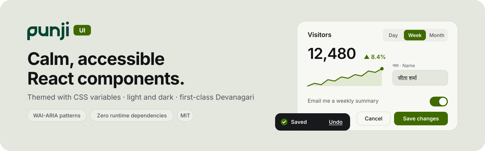

<a href="https://design.punji.app">
  <picture>
    <source media="(prefers-color-scheme: dark)" srcset=".github/assets/punji-ui-banner-dark.svg">
    
  </picture>
</a>

> [!WARNING]
> Work in progress — not ready for public use yet. APIs and styles will change without notice, and nothing is published to npm. Follow along or open an issue; please don't depend on it in production.

<p align="center">
  <a href="https://github.com/20was/punji-ui/actions/workflows/ci.yml"></a>
  <a href="https://scorecard.dev/viewer/?uri=github.com/20was/punji-ui"></a>
  
  <a href="./LICENSE"></a>
</p>

<p align="center">
  <a href="https://design.punji.app">Documentation</a> ·
  <a href="./ROADMAP.md">Roadmap</a> ·
  <a href="./CONTRIBUTING.md">Contributing</a> ·
  <a href="./SECURITY.md">Security</a>
</p>

## Why Punji UI

The figures below come from checks that run on every pull request; the last column names the check.

| | What it means | Checked by |
| --- | --- | --- |
| **Small** | Each module is 0.2 to 2.3 kB (minified and gzipped, React excluded; `Button` 576 B, `Select` 675 B, `DataTable` 618 B, `CommandPalette` 2.23 kB), all 31 together 8.52 kB; every module has a budget that fails the build when exceeded. | [size-limit](./.size-limit.json) |
| **No runtime dependencies** | `dependencies` is empty. React 19 is the only peer. No CSS-in-JS runtime: styles are plain CSS (8.24 kB gzipped for every token and component, 1.02 kB for the tokens alone). | [package.json](./package.json), tarball check |
| **Tree-shakeable** | ES modules, one file per module, `"sideEffects"` lists only CSS. Import from the root or from a subpath such as `@punji/ui/button`. | publint, [are-the-types-wrong](https://arethetypeswrong.github.io) |
| **Accessible** | Real `<button>`, `<a>`, `<select>`, checkbox, radio and range elements, WAI-ARIA patterns (toggle group, tabs with a roving tab stop, switch, combobox, modal dialog with a focus trap, tooltip), arrow keys, Home and End, one visible focus ring, 44 px touch targets. axe-core runs in the tests and fails on any serious issue. | [Vitest + axe-core](./test) (roles, names, keyboard) |
| **Themeable** | Every colour, size and radius is a `--pu-*` CSS variable inside a cascade layer, so your own CSS wins without `!important`. Light and dark follow the system, or force one with `data-theme`. | [token check](./scripts/check-css.mjs) |
| **Verifiable releases** | Published from GitHub Actions with npm Trusted Publishing (no long-lived token) and a provenance attestation, plus an SBOM on every GitHub release. | [release workflow](./.github/workflows/release.yml) |

Type is set for Latin and Devanagari together (Geist and Mukta, both under the
SIL Open Font License), so English and Nepali interfaces share one scale.

## Screenshots

<!-- TODO: light and dark captures of the docs site's component pages. Not added
     yet: the docs site was not rendering when this README was written, and the
     README never shows an image that is not a real capture. -->

Live examples of every component, in light and dark: [design.punji.app](https://design.punji.app).

## Quick start

> Coming soon: the package is not on npm yet. These steps work from the first release.

```sh
npm install @punji/ui
```

Import the CSS once at your app's root, then use the components:

```tsx
import '@punji/ui/styles.css';
import { Button, SegmentedControl } from '@punji/ui';
import { useState } from 'react';

export function Toolbar() {
  const [period, setPeriod] = useState<'day' | 'week' | 'month'>('week');
  return (
    <>
      <SegmentedControl
        label="Period"
        prefix="period"
        value={period}
        onChange={setPeriod}
        options={[
          { value: 'day', label: 'Day' },
          { value: 'week', label: 'Week' },
          { value: 'month', label: 'Month' },
        ]}
      />
      <Button onClick={() => console.log(period)}>Apply</Button>
    </>
  );
}
```

For the smallest CSS, import the tokens, the shared base and only the
components you draw:

```ts
import '@punji/ui/tokens.css';
import '@punji/ui/css/base.css';
import '@punji/ui/css/button.css';
```

Modules that use hooks or their own event handlers carry `'use client'`, so they
work in React Server Component apps such as Next.js without a wrapper.

### Links and routers

The package has no router dependency. A component that takes `href` renders a
plain `<a>`; for in-app paths, pass your router's link once wrapped:

```tsx
import { Link } from 'react-router-dom';
import { Button, type LinkComponent } from '@punji/ui';

const RouterLink: LinkComponent = ({ href, ...rest }) => <Link to={href} {...rest} />;

<Button href="/settings" linkComponent={RouterLink}>Settings</Button>;
```

## Theming

Override any token on `:root` or on a subtree:

```css
:root {
  --pu-color-accent: #4f46e5;
  --pu-color-accent-fill: #4f46e5;
  --pu-color-accent-fill-hover: #4338ca;
  --pu-radius-control: 6px;
}
```

Light and dark follow `prefers-color-scheme`. To force one, set
`data-theme="light"` or `data-theme="dark"` on `<html>` or on any element.
Every token, with its light and dark value: [docs/tokens.md](./docs/tokens.md).

## Components

The modules in this package today. Each one is also its own subpath, the same
subpath Punji's own code imports, and its documentation is on design.punji.app.

<!-- components:start -->
<!-- Generated by scripts/sync-from-web.mjs. -->

| Exports | Subpath | Docs |
| --- | --- | --- |
| `Button` | `@punji/ui/button` | [Button](https://design.punji.app/components/button) |
| `Card` | `@punji/ui/card` | [Card](https://design.punji.app/components/card) |
| `Checkbox` | `@punji/ui/checkbox` | [Checkbox](https://design.punji.app/components/checkbox) |
| `ChoiceGroup` | `@punji/ui/choice-group` | [Choice group](https://design.punji.app/components/choice-group) |
| `CommandPalette` | `@punji/ui/command-palette` | [Command palette](https://design.punji.app/components/command-palette) |
| `CompanySearch` | `@punji/ui/company-search` | [Company search](https://design.punji.app/components/company-search) |
| `Chip`, `ChipRow`, `SegmentedControl`, `SegmentedSwitch` | `@punji/ui/controls` | [Segmented control](https://design.punji.app/components/segmented-control) · [Chip](https://design.punji.app/components/chip) |
| `Drawer` | `@punji/ui/drawer` | [Drawer](https://design.punji.app/components/drawer) |
| `Field`, `NumberField`, `TextAreaField`, `DateField`, `SelectField`, `SymbolField` | `@punji/ui/fields` | [Field](https://design.punji.app/components/field) |
| `Figure`, `Delta` | `@punji/ui/figures` | [Figure and Delta](https://design.punji.app/components/figure) |
| `FloatingTooltip`, `IconHint` | `@punji/ui/floating-tooltip` | [Tooltip and InfoTip](https://design.punji.app/components/tooltip) |
| `InfoTip`, `Tooltip` | `@punji/ui/info-tip` | [Tooltip and InfoTip](https://design.punji.app/components/tooltip) |
| `InlineConfirm` | `@punji/ui/inline-confirm` | [Inline confirm](https://design.punji.app/components/inline-confirm) |
| `PageLayout`, `PageHeader`, `ListSectionHeader`, `ChevronLeft`, `ChevronRight` | `@punji/ui/layout` | [Page layout and header](https://design.punji.app/components/page-layout) |
| `ListFilter` | `@punji/ui/list-filter` | [List filter](https://design.punji.app/components/list-filter) |
| `Live`, `LiveFigure` | `@punji/ui/live-figure` | [Live figure](https://design.punji.app/components/live-figure) |
| `Sheet`, `ToastProvider`, `Dock` | `@punji/ui/overlay` | [Toast](https://design.punji.app/components/toast) · [Sheet](https://design.punji.app/components/sheet) |
| `RangeSlider` | `@punji/ui/range-slider` | [Range slider](https://design.punji.app/components/range-slider) |
| `GroupedCell`, `RowList`, `ValueRow`, `DataRows`, `DataRow`, `Tile` | `@punji/ui/rows` | [Rows and lists](https://design.punji.app/components/rows) |
| `ChevronDown`, `Select` | `@punji/ui/select` | [Select](https://design.punji.app/components/select) |
| `ShowMore` | `@punji/ui/show-more` | [Show more](https://design.punji.app/components/show-more) |
| `EmptyState`, `ToneIcon`, `Note`, `Skeleton`, `SkeletonText` | `@punji/ui/states` | [Empty state and Note](https://design.punji.app/components/empty-state) · [Skeleton](https://design.punji.app/components/skeleton) |
| `StatGrid`, `StatTile` | `@punji/ui/stats` | [Stat tile](https://design.punji.app/components/stat-tile) |
| `StatusPill` | `@punji/ui/status-pill` | [Status pill](https://design.punji.app/components/status-pill) |
| `Switch` | `@punji/ui/switch` | [Switch](https://design.punji.app/components/switch) |
| `DataTable`, `DataListRow`, `Cell` | `@punji/ui/table` | [Data table](https://design.punji.app/components/data-table) |
| `Tabs` | `@punji/ui/tabs` | [Tabs](https://design.punji.app/components/tabs) |
| `moveIndex`, `moveChip` | `@punji/ui/command-keys` | [Formatting and live helpers](https://design.punji.app/utilities/formatting) |
| `compactRs` | `@punji/ui/compact` | [Formatting and live helpers](https://design.punji.app/utilities/formatting) |
| `isNum`, `formatFigure`, `toneOf`, `parseNumber`, `searchSymbols`, `segmentTarget` | `@punji/ui/format` | [Formatting and live helpers](https://design.punji.app/utilities/formatting) |
| `TWEEN_MS`, `TINT_MS` | `@punji/ui/live` | [Formatting and live helpers](https://design.punji.app/utilities/formatting) |

<!-- components:end -->

The kit is mirrored from the Punji web app, which stays its source of truth
([how the sync works](./CONTRIBUTING.md#how-the-kit-is-kept-in-sync-with-punji)).
The rest of the kit, and the pieces that stay in Punji (its logo, its own
navigation), are listed in the [roadmap](./ROADMAP.md).

## Browser support

The last two years of evergreen browsers: Chrome and Edge 111+, Firefox 113+,
Safari and iOS Safari 16.4+ (the versions with CSS cascade layers and
`color-mix()`). React 19 or later.

## Accessibility

Every component follows its [WAI-ARIA Authoring Practices](https://www.w3.org/WAI/ARIA/apg/)
pattern, works with the keyboard alone, draws one visible focus ring, respects
`prefers-reduced-motion`, and passes axe-core with no serious or critical issue in
the test suite. Colour contrast is measured on the documentation site's
foundations page. If something does not work with your assistive technology,
please [open an issue](https://github.com/20was/punji-ui/issues/new/choose).

## Contributing

Read [CONTRIBUTING.md](./CONTRIBUTING.md): how to run the checks, the bar a new
component has to meet, and how releases work. Everyone taking part follows the
[Code of Conduct](./CODE_OF_CONDUCT.md).

## Security

Please report vulnerabilities privately, as described in [SECURITY.md](./SECURITY.md).

## Licence

The code is [MIT](./LICENSE). The fonts it is designed for (Geist, Mukta) are
under the SIL Open Font License and are not bundled. The Punji name and logo are
trademarks and are not covered by the MIT licence: see [TRADEMARKS.md](./TRADEMARKS.md).
