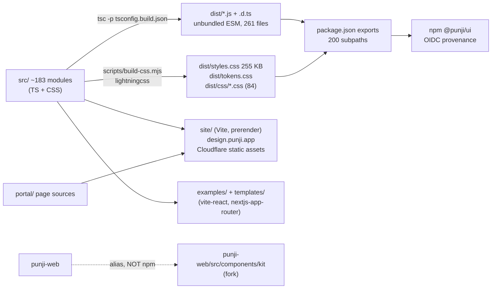
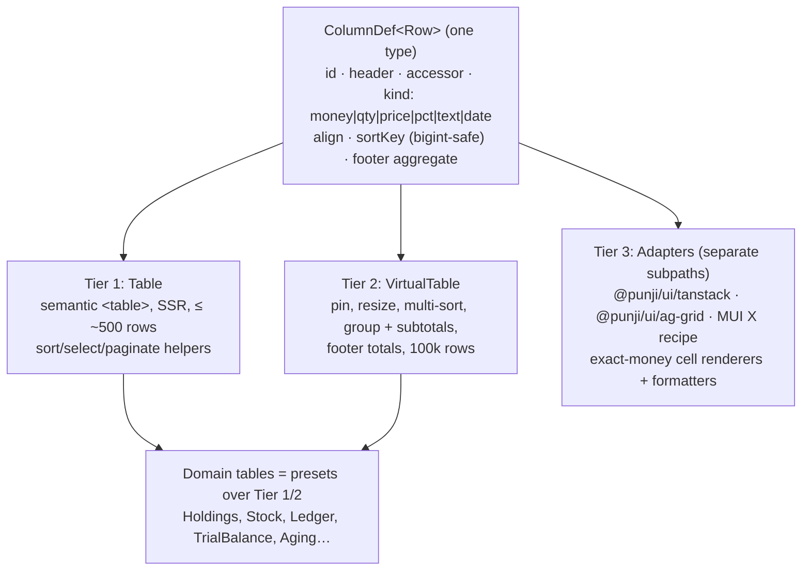
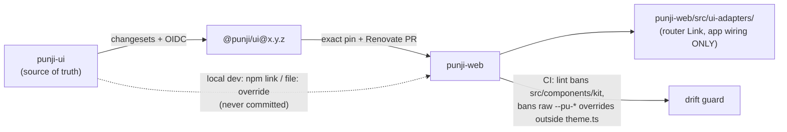
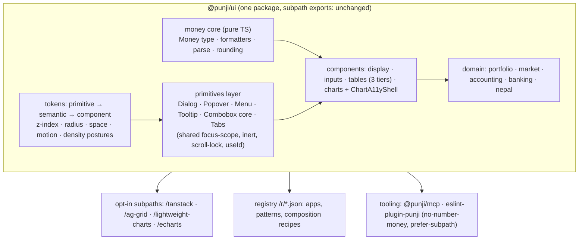

# Punji UI: Framework Excellence Audit

**Scope:** `@punji/ui` 0.2.0 (repo `20was/punji-ui`, `main` at `820dc15`), the docs site https://design.punji.app, and how punji-web consumes the library (read-only).
**Date:** 2026-11-07
**Method:** We read the source and config, ran targeted tests (5 files, 69 tests, all pass), measured bundles with rolldown, ran `npm audit`, checked colour contrast by hand, fetched the live docs site, and did current web research. We did not change any code, dependency, site or punji-web file.
**Location:** `docs/audit/`. That directory already holds the portal and validation audits, so this report lives with them. Root `AUDIT.md` is an older, shorter quality summary; this document replaces it as the framework-level reference.

**How sure we are about each claim:**
- **Measured:** we ran it this session.
- **Read:** we read the source code.
- **Researched:** an external source, cited in §26.
- **Unverified:** stated from general knowledge and flagged in place. Recheck before quoting.

---

## 1. Executive summary

Punji UI is a much stronger codebase than most 0.x design systems. Its core idea, exact money as `bigint` minor units with currency-aware formatting and spoken output, is correct, rare, and well built. The engineering basics are excellent:
- one runtime dependency;
- zero `any` and zero `@ts-ignore`;
- no raw-HTML sinks;
- CSV formula-injection defence on by default;
- tree-shaking that works (a root import of `Button` costs **625 B gzip**, measured);
- a three-job release that publishes through npm Trusted Publishing (OIDC) with provenance and a tarball SHA check.

The weaknesses sit in three places, and none of them is a money-correctness defect:

1. **Two sources of truth (architectural, P0 for the "single source of truth" goal).** punji-web does **not** depend on the published `@punji/ui`. It maps the package name to its own fork of the components in `punji-web/src/components/kit` (169 files, imported by 191 files). The library and the product can drift apart without anyone noticing.
2. **Hand-written overlay and primitive layer with known accessibility gaps (P1).**
   - `Sheet` uses a hard-coded `id`, its focus trap misses some elements, and it has no portal or scroll lock.
   - No modal makes the rest of the page `inert`.
   - `Toast` does not pause on hover or focus.
   - `Tooltip` fails WCAG 1.4.13.
   - There are three separate combobox implementations, and `z-index` is not tokenised.
3. **Inconsistency left over from fast growth (P1–P2).**
   - Four number-formatting paths, three of them `number`-based and rupee-only.
   - About eleven table modules with two column types.
   - A radius scale out of order (`xl` is 8px, `lg` is 16px), and spacing tokens only for 1–4 and 16.
   - Two separate settings for which colour means up (red-up/green-up), which can swap the colours twice.
   - Stale inventory docs that describe punji-web instead of `src/`.

**Verdict.** It is production-ready for its money primitives, financial display components, accounting and banking flows, and charts, in a React 19 app. It is **not yet** production-ready as *the* foundation for an entire product, until the punji-web fork is gone and the overlay layer is consolidated.

The right strategy is not to compete with MUI or Mantine on general primitives. It is to be **the finance layer you add to any React stack**, built from:
- exact money;
- ledger-aware tables;
- accessible financial charts;
- trust-and-safety UX;
- South Asian and emerging-market locale depth;
- AI-native docs.

Punji should also interoperate with the grids and chart engines people already use, instead of rebuilding them.

---

## 2. Repository architecture



| Area | Finding | Evidence |
|---|---|---|
| Package manager | npm with a lockfile. `engines.node >=22.12`, no `packageManager` field. CI runs `npm ci --ignore-scripts`, `lockfile-lint` and `npm audit signatures`. | `package.json`, `.github/workflows/ci.yml` |
| Build | `tsc` emits one JS file per source file, with no bundler. CSS goes through lightningcss into cascade layers. | `tsconfig.build.json`, `scripts/build-css.mjs` |
| TypeScript | `strict`, `noUncheckedIndexedAccess`, `noImplicitOverride`, `verbatimModuleSyntax` and `isolatedModules` are on. `exactOptionalPropertyTypes` is **off**. TypeScript 7.0.2. | `tsconfig.json` |
| React | Peer dependency `react`/`react-dom ^19.0.0`, so React 18 apps cannot use it. 110 files carry `'use client'`, and no hook-using file is missing it. | `package.json`, grep |
| Runtime dependencies | **None** (at audit time one, `@remotemerge/nepali-date-converter`, since removed). | `package.json` |
| Dev dependencies | 25, all pinned exactly. They include vitest 5, vite 8, playwright 1.64, axe-core, fast-check, size-limit, publint, attw and lockfile-lint. | `package.json` |
| Exports | 200 entries, ESM only, `types` plus `default` for each. `sideEffects: ["**/*.css"]`. publint, attw and `check-exports` run in CI. | `package.json` |
| CSS | Plain CSS variables with a `--pu-` prefix and `@layer punji.tokens`, with no CSS-in-JS. The consumer imports `styles.css` or individual per-component files. | `src/styles/` |
| CI | 6 workflows: ci, codeql, dependency-review, docs, release and scorecard. Actions are SHA-pinned and harden-runner is on. `ci.yml` has 4 site shards, a visual and accessibility job, a Next.js consumer build, and a single required "CI OK" gate. | `.github/workflows/` |
| Release | Changesets. Three jobs: version PR, then build and gates (`verify`, `check:consumer`, pack, CycloneDX SBOM), then publish through npm Trusted Publishing with `--provenance` and a tarball SHA check. The publish job runs in the `npm` environment, has no `NPM_TOKEN`, and is gated by the `UI_NPM_RELEASE_ENABLED` variable. | `.github/workflows/release.yml:4,153,182` |
| Docs deploy | `docs.yml` runs `npx --yes wrangler@4.156.0 deploy`, so it fetches wrangler from the registry at deploy time. `wrangler.jsonc` sets `workers_dev: true`. | `.github/workflows/docs.yml`, `wrangler.jsonc` |

**Technical debt.**
- Stale inventory docs: `COMPONENT-INVENTORY.md` still says "0.0.0, not yet published", and `docs/audit/component-matrix.md` and `inventory.json` describe the punji-web kit, not `src/`.
- Two CSS class prefixes are mixed: `kit-` (carried over from punji-web) and `pu-`.
- `firebase-debug.log` sits in the repo root. It is untracked and ignored here, but it is **tracked in punji-web**.

---

## 3. Component inventory

Maturity labels:
- **Solid:** implemented, tested, and accessibility considered.
- **Partial:** works, but has gaps.

Tests live in `test/` (67 files, 38 of which call axe). Every module is referenced by name in tests except `chart-scale`, `combo-step`, `hooks` and `styles`.

| # | Category | Modules | Maturity |
|---|---|---|---|
| 1 | Foundation / primitives | button, card, card-link, avatar, checkbox, switch, choice-group, controls (Chip, SegmentedControl), status-pill, status-tag, meter | Solid |
| 2 | Layout | stack, layout (PageLayout, PageHeader), split-pane, rows, AppShell (in `financial/`) | Solid. No Sidebar/Breadcrumb primitive |
| 3 | Navigation | tabs (Tabs, PanelTabs), pagination, step-list, onboarding-wizard, combo-step, command-palette | Partial (Tabs has no panel contract) |
| 4 | Inputs | fields (Text, Number, Combobox, Textarea), select (native), currency-input, percentage-input, range-slider, otp-input, pin-pad, amount-keypad, secure-field, id/pan/boid/mobile-number-input, calendar, date-picker, date-range-presets, period-selector, nepal-address-picker | Solid (Calendar is best in repo) |
| 5 | Data display | stats, key-stats, metric-tile, fact-list, breakdown, bars, summary-figure, figures (Figure, Delta), show-more, code-block, account-number | Solid, but formatting overlaps (§12) |
| 6 | Feedback | states (EmptyState, Note, Skeleton), inline-state, retry-note, toast (in overlay), session-timeout, trading-halt | Partial (Toast) |
| 7 | Overlays | drawer, drawer-screen, overlay (Sheet, Toast, Dock), popover, info-tip (InfoTip, Tooltip), floating-tooltip, inline-confirm, hold-to-confirm | **Partial: hand-written, inconsistent (§7)** |
| 8 | Tables | table (DataTable), financial (FinancialTable), virtual-table, stock-table, holdings-table, ledger-table, statement-table, aging-table, amortisation-table, trial-balance, interest-rate-table, link-table, table-export, use-table-selection, use-column-visibility | Solid individually, fragmented as a family |
| 9 | Charts | candlestick-chart, performance-chart, depth-chart, column-chart, sparkline, market-heatmap, portfolio-allocation, chart-math, chart-scale | Solid (best-in-class accessibility for hand-written SVG) |
| 10 | Financial primitives | money, money-display, format, compact, price-change, live-figure, live, debit-credit, price-limit | money is excellent; the others overlap |
| 11 | Financial components | portfolio, portfolio-overview, dividend-history, corporate-action-timeline, demat-account-card, order-book, order-ticket, order-list, market-status, market-indices, market-movers, market-breadth, watchlist, bank-account-card, beneficiary-selector, payee-verification, insurance-premium-card, issue-card | Solid |
| 12 | Financial workflows | transfer-review, edis-confirmation, kyc, document-upload, statement-upload, apply-issue-form, allotment-checker, reconciliation-matcher, journal-entry, line-item-editor, loan/deposit/income-tax calculators | Solid. Several should become composition examples (§21) |
| 13 | Dashboards | none in `src/`. 8 apps and 12 showcase patterns on the site | Site-level |
| 14 | App patterns | AppShell, command-palette, list-filter, filter-chip, trust (scam-warning, locked-note) | Partial |
| 15 | Utilities | export (CSV), download, theme (`createTheme`), locale (en/ne/hi/bn), nepal (calendar, decimal, money, mobile, market-format), calculations, ledger core, tax, lending, payments (IBAN, card, bank codes), emvco-qr, qr-code | Solid. Pure modules with no React |
| 16 | Hooks | 14 `use-*` hooks (controllable state, clipboard, storage, media query, hydrated, …), `hooks` barrel | Solid |
| — | Templates | `templates/vite-react`, `templates/nextjs-app-router`, `examples/` | Present |

**Duplicates and overlaps** (detail in §12 and §13):
- Four formatting paths.
- Seven ledger and transaction modules (`transaction-list` vs `transaction-history`, `statement-table` vs `ledger-table`).
- About eleven tables with `Column<K>` vs `FinancialColumn<T>`.
- Five overlay implementations.
- Three comboboxes.

**Prop vocabulary is inconsistent:**
- Button uses `variant`, ControlSize uses `sm|md|lg`, and Chip uses `size='m'`.
- Note uses `tone/quiet/plain`.
- Labels arrive three ways: a `label` string, a `labels` object, or locale context.

---

## 4. Current framework assessment

| Dimension | Grade | Basis |
|---|---|---|
| Money correctness | **A** | `src/money/money.ts`: bigint minor units, exponent from Intl with override, strict parser returning `empty/partial/invalid/valid`, `formatSpoken`, display-rounded compact notation computed without `Number` |
| Engineering hygiene | **A** | 0 `any`, 1 runtime dependency, pinned devDependencies, SHA-pinned CI, OIDC provenance |
| Tree-shaking / bundle | **A−** | Measured (§8). Per-subpath budgets in `.size-limit.json` |
| Financial domain breadth | **A−** | Portfolio, market, accounting, banking, lending, tax, Nepal IPO. Nothing comparable exists in generic kits |
| Charts | **A−** | Accessible SVG with a keyboard cursor, live region and hidden data table. No zoom or brush, by design |
| Accessibility (overall) | **B** | Excellent for Calendar, charts, CommandPalette, native Select and HoldToConfirm. Defects in Sheet, Toast, Tooltip, Tabs and reduced motion |
| Design tokens | **C+** | Good CSS-variable and cascade-layer base, high-contrast themes checked. But the scale is out of order, there is no z-index scale, no primitive or component token layer, and sparse spacing |
| API consistency | **C+** | Variant, size and label vocabularies differ, there are two column types, and formatting overlaps |
| Testing | **B** | 67 files, axe in 38, Playwright visual tests, fast-check. No coverage threshold and no type tests |
| Docs / AI-readability | **A−** | llms.txt, llms-full.txt, per-page Markdown, registry, API tables generated from `.d.ts`. Component pages are thin on keyboard and accessibility detail |
| Single source of truth | **D** | punji-web runs a fork (§19) |

---

## 5. Benchmark research

Full sources are in §26. Evidence labels: [R] researched this session, [P] from the repo's prior research (`docs/research/COMPETITIVE-2026.md`), [U] unverified.

### 5.1 Component systems

| System | Exceptional at | Punji should learn | Punji should avoid | Verdict |
|---|---|---|---|---|
| **Mantine 9** | Coherent hooks + components + dates + charts in one package; llms.txt [P]. v9 requires React 19+ and Recharts 3+ [R] | A single, consistent prop vocabulary across every component; quality of the hooks docs | Float `NumberInput` for money | Build independently; copy the developer-experience patterns |
| **MUI / MUI X** | Breadth; Data Grid, Charts, Pickers; official MCP [P] | A clear open-core feature matrix | Emotion runtime; money as `number`. **Since 2026-04-08, Pro/Premium are licensed per application, and indirect use through a wrapper counts** [R] | Interop recipe only. Never a dependency (the licence would reach Punji's consumers) |
| **Ant Design** | Dense enterprise tables, ProTable/ProForm, **token algorithms** (compact and dark themes generated from one seed colour) [P] | Algorithmic density and dark derivation; per-component `.md` | Float InputNumber; visual heaviness | Adapt the token-algorithm idea |
| **Chakra v3 / Ark (Zag)** | State-machine-driven primitives, typed slot recipes [P] | Slot-recipe typing for component tokens | — | Reference only |
| **Radix Primitives** | Accessible unstyled primitives; now stewarded by WorkOS, slower cadence [R, weak source] | Focus-management model, `asChild` | Depending on it, given the uncertain cadence | Do not depend |
| **Base UI** | Stable, made by MUI/Radix/Floating UI alumni, default in shadcn/ui [R, weak source] | Field, Combobox and Dialog APIs, `render` composition | — | **Behavioural benchmark** for Punji's overlays and combobox |
| **React Aria** | Best accessibility and i18n available: NumberField with any numbering system, calendars, RTL, IME [P] | Use as the **test oracle**: CurrencyInput, Tabs and Dialog should match its behaviour | Its API verbosity | Adapt the patterns; optionally build the overlay core on its hooks (§22) |
| **Headless UI** | Tailwind-centric headless set | — | — | Ignore |
| **shadcn/ui** | Copy-in distribution, `registry.json`, namespaced registries, MCP [P] | Punji already ships `/r/*.json`. Keep the registry for **patterns and apps** | Copy-in for **money logic** (copied code never receives rounding or security fixes) | Adopt the model for patterns only |
| **Tailwind v4** | CSS-first `@theme`, cascade layers; stable since 2025-01-22 [R] | Punji's `@layer` and CSS variables already compose with it | — | Ship an `@theme inline` mapping of the `--pu-*` tokens |

### 5.2 Tables

| Option | Status | Verdict |
|---|---|---|
| **TanStack Table v9** | **Stable since 2026-08-04.** `useReactTable` is renamed `useTable`, features must be declared explicitly, the core grew from about 14 to 25 kB, and cell and range selection is new [R]. `docs/research/table-2026-10-30.md` predates v9 and is stale. | Optional headless engine through an **adapter**, not a hard dependency |
| **TanStack Virtual** | The standard row virtualiser [U] | Keep Punji's own virtualiser; publish an interop recipe |
| **AG Grid** | Community free. Enterprise is $999 per developer, perpetual, per deployment. Pivot, aggregation and Excel export are Enterprise-only [R] | **Interop:** exact-money cell renderers and `valueFormatter`s |
| **MUI X Data Grid** | Grouping and aggregation need Premium; licensing is per application [R] | Interop recipe only |

None of these four treats money as anything but a float `valueFormatter`, and none has ledger semantics (running balance, debit and credit columns, reconciled totals). **That gap is Punji's table opportunity, not general grid power.**

### 5.3 Charts

| Library | Rendering / accessibility | Size | Licence | Verdict |
|---|---|---|---|---|
| **TradingView Lightweight Charts v5** | Canvas, no DOM semantics | ~35 kB base (vendor claim) [R] | Apache-2.0 **plus a required attribution link** (`attributionLogo` satisfies it) [R] | Optional **adapter** for real-time candles, always paired with Punji's table twin |
| **ECharts 6.x** | Canvas or SVG, built-in ARIA descriptions and **decal patterns** [R] | Large; tree-shakable [U] | Apache-2.0 | Interop only; learn from its decals |
| **Recharts v3** | SVG; `accessibilityLayer` on by default [R] | not measured | MIT | Do not depend; learn from its keyboard layer |
| **Visx** | Low-level d3 primitives | modular | MIT | Reference only |
| **uPlot** | Canvas, fastest time series, no accessibility story [R] | ~45–50 kB min [R] | MIT | Optional adapter for very large tick streams |

### 5.4 Standards consulted

WCAG 2.2 AA, WAI-ARIA APG (Dialog, Combobox, Tabs, Grid, Tooltip), OWASP CSV Injection, and npm Trusted Publishing (GA 2025-07-31) [R]. We did not fetch the WCAG and APG texts themselves this session, so the criteria are cited from knowledge.

---

## 6. Security audit

| Check | Result | Severity |
|---|---|---|
| `dangerouslySetInnerHTML`, `innerHTML`, `eval`, `new Function`, `insertAdjacentHTML`, `postMessage` | **0 hits** in non-test `src/` (read) | ✓ |
| `target="_blank"` | Every use adds `rel="noopener noreferrer"` (`Button.tsx:80`, `CardLink.tsx:54`, `CheckRow.tsx:193`) | ✓ |
| CSV export | `src/export/csv.ts` neutralises leading `= + - @`, TAB, CR, LF and the full-width variants. On by default and idempotent | ✓ (P4: confirm that numeric columns keep negative amounts numeric; OWASP advises sanitising text columns only) |
| `npm audit` (production and full) | **0 vulnerabilities** (measured) | ✓ |
| Secrets in `dist/`, `site/dist/` | Grepped for AWS, Stripe, Google, GitHub, npm, Slack and private-key patterns: none found (measured) | ✓ |
| Supply chain | Pinned devDependencies, lockfile-lint, `npm audit signatures`, CodeQL, Scorecard, dependency-review, SHA-pinned actions, OIDC provenance, SBOM | ✓ Exemplary |
| `href` from props | `Button`, `StatusPill`, `Rows`, `LinkTable`, `CardLink` and `Layout` pass `href` through with no `javascript:` filter. React 19 blocks `javascript:` on intrinsic `<a>`, but **not inside a consumer-supplied link component** | **P3** |
| `DocumentUpload` preview | `` comes from the caller | P4 (document: use object URLs only) |
| Docs deploy | `npx --yes wrangler@4.156.0` is fetched at deploy time instead of pinned in the lockfile | **P3** |
| CSP / security headers | `site/dist/_headers` is not in the current build output, and `site/public/_headers` does not exist. We **could not confirm** a CSP on design.punji.app | **P3** (rebuild and inspect the live response headers) |
| `workers_dev: true` | A second public hostname (`*.workers.dev`) serves the docs | P4 |
| `firebase-debug.log` | Ignored here, but **tracked in punji-web's git**. Not inspected for tokens | **P2** (punji-web owners) |
| Clipboard | Copy only (`AccountNumber`, `PaymentReceipt`); the components already warn that the clipboard is shared with other apps | ✓ |
| Storage | Only `useStorage`, which is documented as "not for secrets" | ✓ |
| Account masking | `AccountNumber` masks the display, but the full value is in props and the DOM | P4 (document that masking is presentation only) |

**The line between UI and backend security.** `hold-to-confirm`, `edis-confirmation`, `kyc`, `session-timeout`, `secure-field`, `scam-warning`, `payee-verification` and `locked-note` are **user-experience safeguards, not controls**. Every one must be re-enforced on the server: authorisation, step-up authentication, limits, payee checks and session expiry. **P3:** every such component page should carry a standard "This does not enforce anything" callout, and `docs/TRUST.md` should open with it. Otherwise integrators may believe that a hidden button, a 1.5-second hold or a client-side validator protects money.

---

## 7. Accessibility audit

We read behaviour against the APG patterns and ran the keyboard tests in `overlays`, `tabs`, `virtual-table`, `financial-charts` and `select` (all pass). There are **no** Radix, React Aria, Base UI or Floating UI dependencies: every interactive primitive is hand-written.

| Component | Status | Defects |
|---|---|---|
| Calendar / DatePicker | **Exemplary** | APG grid, roving focus, PageUp/PageDown with Shift for year, live heading, AD and BS calendars |
| Charts | **Exemplary** | One tab stop, arrow keys plus Home/End/Esc, polite announcements, hidden `<table>` (up to 500 rows), direction stated in words, hollow up candles |
| CommandPalette | Strong | Fixed `id="kit-cmd-list"` (`CommandPalette.tsx:209,233`), so two instances produce duplicate ids |
| Select | Strong | Native `<select>` plus `appearance: base-select`. No multi-select or search |
| HoldToConfirm | Thoughtful | A 1.5 s key hold is a motor-access barrier. The cooling-off mode should be the documented alternative |
| Drawer | Good | No `inert` on the rest of the page; scroll lock saves and restores naively (stacked overlays break it); the tab-wrap filter `offsetParent !== null` drops `position: fixed` children |
| **Sheet** (`overlay/Overlay.tsx:59-60`) | **Defective** | Hard-coded `id="kit-sheet-title"`. Focus selector is only `button, input, select, [href]`, which skips textarea, `[tabindex]` and summary. No portal, no scroll lock. Initial focus lands on the first button, which is the destructive action in a "Sell 40 NTC?" confirm |
| **Toast** | **Defective** | No pause on hover or focus (WCAG 2.2.1); a 6 s Undo; no timer cleanup on unmount; an `aria-live` container wraps `role=alert/status` children, so messages can be announced twice |
| **Tooltip / InfoTip** | **Fails WCAG 1.4.13** | The bubble cannot be hovered (`onPointerLeave` on the trigger closes it, `InfoTip.tsx:84,167`); it closes on any scroll; a pinned InfoTip uses `role=tooltip` for interactive content |
| Tabs | Partial | Renders no `tabpanel`; a single `aria-controls` for every tab; no vertical arrow keys; no RTL arrow swap |
| Tables | Good | Native semantics, `aria-sort`, labelled scroll regions, `role=status` for empty and loading. The virtual table adds `aria-rowcount/rowindex` and keyboard-operable resize handles |
| Reduced motion | **Gap** | Only 14 of ~100 stylesheets handle `prefers-reduced-motion`, and there is no global guard in `base.css` |
| Colour-only meaning | Partial | `Delta` does it right (sign, arrow, spoken word, colour). In the light theme, gain `#3f6a00` and loss `#a3321f` differ in **hue only** (contrast between them 1.08:1). `--pu-color-series-3` is **2.69:1** against the surface, below the 3:1 non-text minimum |

**WCAG 2.2 items to own for finance:**
- **2.4.11 Focus Not Obscured.** Sticky headers, sticky totals and docked order tickets need `scroll-padding` tokens.
- **2.5.8 Target Size.** Compact density must never drop a hit area below 24×24 px.
- **3.3.7 Redundant Entry.** Payment and KYC wizards should carry data forward instead of asking for it again.
- **3.3.8 Accessible Authentication.** OtpInput and PinPad must allow paste and password managers.

---

## 8. Bundle and performance audit (measured)

**Reproduce:**
```sh
npm run build                       # if dist is stale
node scripts/size-report.mjs        # (proposed) or the audit's sz.mjs: walk dist/, sum raw/gzip/brotli
npx rolldown / esbuild per entry    # react, react-dom external; --minify
npm run size                        # existing size-limit budgets
node scripts/bench-table.mjs        # existing table benchmark (not run in this audit)
```

**Whole `dist/` (per-file sums; a bundler would compress somewhat better):**

| Type | Files | Raw | gzip | brotli |
|---|---|---|---|---|
| JS | 261 | 1,185,590 B | 423,308 B | 365,207 B |
| CSS | 86 | 512,356 B | 111,810 B | 92,416 B |

**Single-entry cost (minified, tree-shaken, React external):**

| Import | min | gzip | brotli |
|---|---|---|---|
| `import { Button } from '@punji/ui'` | 1,164 | **625** | 555 |
| `@punji/ui/button` | 1,164 | 625 | 555 |
| `./command-palette` | 5,697 | 2,288 | 2,047 |
| `./table` | 6,786 | 2,552 | 2,332 |
| `./nepal-address-picker` | 6,934 | 2,991 | 2,648 |
| `./money-display` | 9,379 | **4,171** | 3,728 |
| `./performance-chart` | 10,409 | 4,500 | 4,142 |
| `./virtual-table` | 12,623 | 5,238 | 4,797 |
| `./candlestick-chart` | 13,542 | 5,605 | 5,150 |
| `./stock-table` | 27,301 | 10,509 | 9,506 |
| `./holdings-table` | 28,857 | 10,678 | 9,590 |
| `import * from '@punji/ui'` | 533,435 | 175,547 | 143,655 |

**Findings:**
1. **Tree-shaking works.** Root and subpath imports cost the same. Unbundled ESM plus `sideEffects` plus flat re-exports is the right design. Keep it.
2. **CSS is the bigger opportunity.** `dist/styles.css` is **255 KB raw** (about 50 KB+ gzip, estimated from the per-file totals). Most apps import it whole. Recommendation: document a per-component CSS import as the default for production, and add a CSS budget to `.size-limit.json`.
3. **`money-display` at 4.2 KB gzip** is heavy for a formatter. Trace it: probably the locale tables plus the spoken-output code are reachable. Split `formatSpoken` and compact notation into lazily reachable paths, aiming for ≤2 KB.
4. **Large tables are not virtualised by default.** Only `VirtualFinancialTable` is. `StockTable` and `HoldingsTable` render every row. Add an opt-in `virtualize` prop, or a documented threshold (for example above 500 rows, switch to the virtual table).
5. **Charts are SVG with decimation.** The ceiling is DOM size, not CPU. That is fine for daily and intraday candles; for tick streams, point people to the canvas adapters (§14).
6. **SSR.** No module-scope `window` access (one lazy `window.matchMedia` in `CompanySearch.tsx:31`). A Next.js consumer build runs in CI.

**Targets to set** (to be calibrated by running `bench-table.mjs` and `bench-charts.mjs` in CI; **these are proposals, not claims**):
- Each primitive ≤2 KB gzip, which `.size-limit.json` already largely enforces.
- `MoneyDisplay` ≤2.5 KB.
- Every heavy component ≤12 KB.
- A CSS budget for each component file.
- First render of a 10k-row virtual table, and 60 fps on scroll, recorded on a fixed CI runner and tracked over time.

---

## 9. Type safety audit

- **0** real uses of `any`, `@ts-ignore` or `@ts-expect-error` (read).
- Generics exist where they should: `StockTable<T extends Quote>`, `SelectOption<T extends string>`, and a generic `Table`.
- Money parsing returns a discriminated union (`state: 'valid'` with `minor: bigint`).
- `use-controllable-state` gives every component the same controlled/uncontrolled behaviour.

**Gaps:**
- **No type-level tests** (`expectTypeOf`/tsd) for a 200-subpath public API (**P2**).
- **No `Money` value type.** APIs take a bare `bigint` plus a separate formatter, so the type system does not stop you mixing NPR and USD amounts (**P1, financial**).
- Price, quantity and basis points are not distinct branded types.
- `exactOptionalPropertyTypes` is off (P4).
- Two column-definition types (`Column<K>`, `FinancialColumn<T>`).

---

## 10. Testing audit

| Layer | State |
|---|---|
| Unit / component | vitest with jsdom. 67 files, grouped by theme rather than one per component |
| Accessibility | axe in 38 files, plus an axe sweep of every docs page at 2 widths × 2 themes across 4 CI shards. `check-contrast.mjs` covers the tokens |
| Keyboard | About 34 files use `userEvent`. Not tested: `inert`, duplicate ids, toast pausing, focus restore in CommandPalette |
| Visual regression | Playwright, 6 viewport projects (3 gating), baselines generated in Docker on Linux, 0.1% tolerance |
| Property-based | fast-check, with `test:deep` running 2000 iterations |
| Performance | `test/bench`, `test/bench-charts`, `chart-performance.test.tsx` |
| Coverage | **None configured and no threshold (P2)** |
| Type tests | **None (P2)** |
| Cross-browser | Not evident beyond Playwright's Chromium defaults. Add WebKit for Safari, since many finance users are on iOS |
| Screen reader | No recorded NVDA, VoiceOver or TalkBack results |

**Sustainable strategy:**
1. Turn on v8 coverage with a ratchet: record the current floor and never let it fall.
2. Add `expectTypeOf` tests for every generic component and for the money API.
3. Turn the APG keyboard tables into a shared test helper, so every interactive component is checked against its pattern.
4. Add WebKit as a Playwright project.
5. Run a quarterly manual screen-reader pass on five money tasks (enter an amount, confirm a payee, enter an OTP, read a table, read a chart) and publish the results (§16).

---

## 11. Design system audit

**Strong foundation:**
- `--pu-` CSS variables inside `@layer punji.tokens`, so consumer CSS wins without `!important`.
- Light and dark themes through `prefers-color-scheme` or `data-theme`.
- `light-hc` and `dark-hc` themes, plus `prefers-contrast: more` and `forced-colors` support, checked to AAA.
- Density (compact, comfortable, spacious) kept separate from colour.
- `--pu-dir` for RTL and `--pu-tap-min: 44px` on coarse pointers.
- Three finance palettes, including blue/orange for colour-blind users.
- `createTheme` checks contrast as it builds a theme.

**Defects:**

| Token area | Problem | Fix |
|---|---|---|
| Layering | One flat semantic layer. No primitive scale (`--pu-gray-500`) and no component tokens (`--pu-button-bg`) | Three layers: primitive → semantic → component. Component tokens only for the 10–15 components people theme most |
| Radius | `sm 0.5rem`, `md 16px`, `lg 16px`, `xl/2xl/3xl 8px`, `card 24px`, `control 12px` (`tokens.css:71-79`). Out of order | A monotonic scale `xs 4 · sm 6 · md 8 · lg 12 · xl 16 · 2xl 24`, keeping `control` and `card` as semantic aliases |
| Spacing | Only `1,2,3,4,16`; components hard-code values like `8px` and `12px` | A 4px-based scale 0–16, with lint rejecting raw px in `src/styles` |
| z-index | Hard-coded 1–100; Drawer 60 = palette 60, Popover 61, company-search 70, tooltip and skip-link 100 | `--pu-z-{base, sticky, dropdown, overlay, modal, popover, toast, tooltip}` |
| Type | Fluid `clamp()` sizes with no weight, line-height or **tabular-number** tokens | Fixed sizes for data-dense surfaces, plus `--pu-font-numeric: tabular-nums` |
| Motion | `fast` and `base` only, and no global reduced-motion switch | A global `@media (prefers-reduced-motion: reduce)` that zeroes durations |
| Breakpoints | Literals `767/1024/1256` | Documented constants (`breakpoints.ts`) plus container queries |
| Financial semantics | `gain`, `loss`, `warn`. Missing `flat/neutral`, `pending`, `info`, and "negative by design" (expenses) | Add these; document that the sign drives meaning, not the colour |
| Up-colour convention | `createTheme({finance:'red-up'})` **and** a per-chart `convention` prop. Using both swaps twice | One source of truth: the theme sets `--pu-finance-convention`, and charts read it |
| Contrast | Light gain and loss differ by hue only (1.08:1); series-3 is 2.69:1 | Make gain and loss differ in lightness too; fix series-3; add decal or pattern options to heatmaps and allocation charts |

**Visual direction.** Finance UIs earn trust through *precision*:
- tabular numerals everywhere numbers sit in columns;
- right-aligned amounts aligned on the decimal point;
- restrained colour, with gain and loss used only on the *delta*, never on whole rows;
- dense defaults in tools and comfortable defaults in consumer flows;
- fewer, firmer radii (8–12px for controls; the 24px card radius reads as consumer fintech and is wrong for back-office work);
- a single elevation for overlays.

Ship two **density presets as product postures** (Consumer and Desk), not just a spacing multiplier.

**API consistency.** Standardise on:
- `size: 'sm'|'md'|'lg'`;
- `variant` for visual style and `tone` for semantic colour;
- `labels` for i18n overrides, falling back to locale context;
- the `pu-` class prefix (keep `kit-` as a deprecated alias for one minor version).

Publish this as `docs/API-CONVENTIONS.md` and lint it in `check-*`.

---

## 12. Financial component audit

### 12.1 Primitives

`src/money/money.ts` is the crown jewel:
- bigint minor units, with the exponent from Intl (JPY 0, USD 2, KWD 3);
- `format`, `formatToParts`, `formatSpoken`, and display-rounded `formatCompact` (lakh/crore or K/M/B);
- a strict `parse`, `toCanonicalInput` (Devanagari and Arabic-Indic digits), and live `formatDecimalInput`;
- an accounting style and a south-Asian grouping override.

Calculation is kept apart from formatting: `calculations/`, `ledger/core.ts`, `tax/` and `lending/` are pure modules with no React. **Correct, and rare.**

**The problem is the other three paths:**

| Path | Input | Currency-aware | Verdict |
|---|---|---|---|
| `money` / `MoneyDisplay` | bigint | Yes | **Canonical** |
| `figures` (Figure, Delta) + `format` + `internal/number.ts` | number | No (`kind:'rs'`, en-IN) | Wrap `createMoneyFormatter`, or limit to non-money figures (percentages, ratios) |
| `compact` (`compactRs`) | number | No (Rs) | Deprecate in favour of `formatCompact` |
| Charts' default axis and labels | number | en-IN NPR by default | Take a `formatter` prop with no NPR default |

**Primitives to add:**
- A `Money` value type, `{ minor: bigint; currency: CurrencyCode }`, with typed operations that refuse mixed currencies.
- `FxRate` with a timestamp and source, displayed as `1 USD = NPR 133.40 · 14:02 NPT · NRB`.
- `BasisPoints`.
- Branded `Price` and `Quantity` types.
- A `Period` type (fiscal year, quarter, BS fiscal year).
- A `DataFreshness` primitive (live, delayed 15 min, end of day, stale).

Formatting stays separate from arithmetic. Presentation components never do arithmetic on `number`.

**Display conventions to standardise and document:**
- **Negatives:** minus by default, parentheses in accounting style.
- **Zero:** `0.00`, never shown as gain or loss.
- **Missing:** an em dash with spoken "No value".
- **Compact notation:** only where full precision is available on hover or focus.
- **Copy:** copy the full, ungrouped, canonical value.
- **Sort:** by `minor`, never by the formatted string.
- **Alignment:** tabular numerals, right-aligned.

### 12.2 Domain coverage

| Domain | Coverage | Gaps |
|---|---|---|
| Portfolio | Allocation, overview, holdings, dividends, corporate actions | Performance attribution, tax-lot view, comparison against a benchmark |
| Market | Order book, ticket, list, breadth, heatmap, movers, status, halts, indices, watchlist | Time-and-sales tape, ticker strip, OHLC + fundamentals summary card |
| Accounting | Ledger, journal, trial balance, reconciliation, aging, invoice, payslip | Statement components (P&L, balance sheet, cash flow) with period columns |
| Banking / payments | Beneficiaries, payee verification, transfer review, QR, EMVCo, receipts, timelines, IBAN and card validation | Recurring payments, standing instructions |
| Personal finance | Partial (calculators, account cards) | Budget progress, cash-flow chart, net worth over time |
| Lending, tax | Amortisation, EMI, deposits, income tax, TDS | — |
| Nepal | BS calendar, address, NEPSE fees, IPO/EDIS, PAN, BOID, mobile | Unique; keep it in separate subpaths |

---

## 13. Table and grid architecture

**Current state.** Every table is hand-written with **no TanStack**. The tables are deliberately controlled: the caller sorts and filters, and helpers such as `nextSortRules`, `compareByRules` and `paginate` are provided. That is the right stance for a design system.

| Feature | DataTable / FinancialTable | VirtualFinancialTable |
|---|---|---|
| Sort | Single column | Multiple columns, with priority |
| Selection, search, pagination | Yes | Selection, search |
| Sticky header | Yes | Yes |
| Resize, pin | No | Yes (pointer and keyboard, RTL-aware) |
| Virtualisation | No | Yes |
| Numeric alignment, responsive hide | Yes | Numeric alignment |
| Empty, loading and error states | Yes | Yes |
| Export, column visibility | Through `table-export` and `use-column-visibility` | Same |
| Grouping, subtotals, footer aggregation, tree rows, row expansion | **No** | **No** |
| Cell navigation / edit (`role=grid`) | No | Row cursor only |

**Recommended architecture:** three tiers with one column type.



- **Build it ourselves (Tiers 1 and 2):** money-kind columns, sorting on the bigint value, running balances, debit/credit pairing, **group and subtotal plus footer totals that reconcile** (show a mismatch badge when the totals don't match), density, and accessibility. This is where Punji is differentiated.
- **Wrap (Tier 3):** a TanStack Table v9 adapter for teams that want headless state (faceting, global filter, cell-range selection), and AG Grid / MUI X cell renderers for pivot desks.
- **Do not build:** pivoting, spreadsheet editing, Excel export with formulas, or server-side row models.
- **Consolidate:**
  - merge `Column<K>` and `FinancialColumn<T>`;
  - turn `stock-table`, `holdings-table`, `ledger-table`, `statement-table`, `aging-table` and `trial-balance` into column presets plus small wrappers;
  - merge `transaction-list` and `transaction-history`.

---

## 14. Chart architecture

**Current state:**
- Hand-written SVG with no dependency.
- Chart types: candlestick and OHLC (volume pane, SMA/EMA), line and area performance (with benchmark), depth, column, sparkline, treemap heatmap, and allocation.
- Interaction: pointer crosshair and keyboard cursor. No zoom, pan, brush or drawing tools.
- Large series are decimated.
- Accessibility is the best of any library surveyed.

**Strategy: keep SVG as the owned default and add canvas adapters behind the same accessibility contract.**
- The owned SVG charts handle 95% of financial dashboards: performance, allocation, daily and intraday candles, depth, P&L.
- Add **Waterfall** (P&L bridge), **Cash-flow** (stacked in and out) and **Net-worth over time** as the next owned charts. Do not add pie, scatter or gauge charts.
- Add an **`ChartA11yShell`**: the hidden data table, spoken summary, keyboard cursor and live region, factored out and published so it can wrap *any* chart.
- **Adapters (optional subpaths, never in the core):** `@punji/ui/lightweight-charts` for streaming candles at tick rates, including the attribution option, and an `@punji/ui/echarts` theme for exotic chart types. Both are wrapped in `ChartA11yShell` and pick up Punji tokens and money formatters.
- Zoom and brush: add a **range-selector** control (1D, 5D, 1M, YTD, 1Y, Max plus a brush) that changes the data window. Do not build in-chart zoom gestures in SVG.
- Fix series-3 contrast, offer decal patterns, and let charts read the single theme-level up-colour convention.

Avoid putting more than one chart library in the core. Adapters are opt-in and measured in CI.

---

## 15. Documentation audit

**What exists (fetched and read in `site/`):**
- About 190 pages.
- Cmd-K search, built on Punji's own CommandPalette.
- A grouped sidebar (Get started 12, Apps 8, Foundations 4, about 12 domain groups, Showcase 12).
- Every component page has a copyable subpath import, a gzip size badge, and "View as Markdown / Open in ChatGPT / Open in Claude" links.
- Examples / Code / API / Usage tabs, with **API tables generated from the shipped `.d.ts`** (the build fails if docs are missing).
- A Usage section with when to use, when to avoid, keyboard, accessibility, responsive and related components.
- A no-JS prerender, and per-example light and dark previews.
- `llms.txt`, `llms-full.txt` (1.3 MB), a per-page `index.md`, a `components.json` manifest, and a `/r/*.json` shadcn registry.

**Gaps, in order of value:**
1. **Component pages are thin where it matters.** On MoneyDisplay, the keyboard section is one line and the accessibility section is three bullets. Missing on every page:
   - the token table (which `--pu-*` variables it reads);
   - stability (stable, beta or experimental) and "since" version;
   - a per-component changelog;
   - a sample of what a screen reader says;
   - the APG pattern it follows;
   - RTL and locale notes;
   - a UI-only security callout where relevant.
2. **No props playground** and no global locale, currency, density or theme switcher across demos.
3. **Foundations has only 4 pages.** Missing:
   - a full token reference (density, motion, z-index, focus);
   - gain/loss and colour-blind rules;
   - **money-handling rules** (bigint, rounding modes, ISO vs CLDR minor units);
   - content guidelines (amounts, error copy, scam warnings);
   - data-visualisation guidelines.
4. **Versioning:** only the latest version is hosted. There is no stability or deprecation policy and no migration-guide template.
5. **Search** covers titles, leads and export names only. Add full-text search over usage, accessibility and keyboard sections, plus finance synonyms ("crore", "cheque", "IPO", "NEPSE").
6. **Information architecture:** "Contributing" links to `/get-started/agents/`, which will confuse human contributors.
7. **Trust page:** no public accessibility conformance statement. Provenance and SBOM are not linked or explained (`npm audit signatures`).
8. Copy buttons on code blocks and npm/pnpm/yarn/bun tabs: **verify** them in a browser (we could not confirm from the fetched text).

---

## 16. Showcase audit

The **8 full apps** (trading terminal and others) and **12 showcase patterns** are the strongest asset. Each has live simulated data, keyboard shortcuts, accessibility notes, a "Limits" section and a one-line `shadcn add`. That puts them ahead of every generic kit.

**Missing:**
- **Back-office / ops:** a reconciliation queue, maker-checker approvals, exception handling, audit trail.
- **Multi-currency treasury:** FX exposure and cross-currency balances (which also forces the `Money`/`FxRate` types into existence).
- **Financial statements:** P&L, balance sheet and cash flow with period comparison, plus a **printable / PDF statement** view.
- **Wealth / advisor:** a client book, rebalancing proposals, a drift view.
- **Personal finance:** budget, cash flow, net worth, goals.
- **"Run locally / StackBlitz"** for every app, using `templates/`.
- **States gallery:** loading, empty, error, stale data, market closed, permission-limited, for every app.

**What would make it exceptional:**
1. A **locale switcher** that re-renders every app in en-NP, en-IN, ne, ar, ja and en-US, so the money and calendar depth shows up in the first ten seconds.
2. A **"Money correctness lab"**: float vs bigint side by side, live (`0.1 + 0.2`, ¥ vs KWD minor units, lakh grouping, rounding modes).
3. **Conformance cards** on each component: axe result, keyboard script, spoken output, APG pattern, size, SSR-safe, last-tested date.
4. A **Desk vs Consumer** posture toggle on each app.
5. **Figma variables** generated from `tokens.css`.

---

## 17. Developer experience audit

| Task | Today | Improvement |
|---|---|---|
| Find the right component | Cmd-K over titles; the sidebar | Full-text search, synonyms, and a "which table / which formatter?" decision page |
| Understand the API | Generated props tables (excellent) | Add type examples, controlled vs uncontrolled notes, and stability |
| Copy working code | Import plus Code tab; registry for patterns | Copy button on every block; StackBlitz per app |
| Learn composition | 12 patterns, 8 apps | Recipes: "money column in AG Grid", "statement with period columns" |
| Build a dashboard | Apps plus templates | A `create-punji-app` template choice (Desk / Consumer) |
| Understand tokens | 4 foundation pages | A full generated token reference |
| Avoid mistakes | Usage section | **Lint rules** (§22) plus MCP review |
| AI agents | llms.txt, `components.json`, registry, per-page Markdown | **An MCP server** (list, API, example, rules, `review_usage` that flags `number` money) |

An MCP server is justified here, not novelty: the main way Punji gets misused, an AI writing money as `number` or picking the wrong table, can be detected by a tool.

---

## 18. Package publishing assessment

This is **excellent** and the most mature part of the repo:
- Changesets, with the version-PR merge kept as a human gate.
- `verify` and `check:consumer` (Next.js and Vite consumers) gate the build.
- The tarball is packed once, checked by SHA, and published through **npm Trusted Publishing (OIDC)** with provenance, from the `npm` environment, with no long-lived token.
- A CycloneDX SBOM, plus publint, attw and `check-exports`.

**Remaining work:**
- **Pre-1.0 stability policy.** State what may break in a 0.x minor release, and mark each export stable, beta or experimental, with a `@stability` JSDoc tag surfaced in the docs.
- **Deprecation mechanism:** `@deprecated` JSDoc, plus a dev-only console warning, kept for at least one minor version.
- **Pin wrangler** as a devDependency instead of `npx --yes`.
- **A React 18 decision:** state "React 19 only" explicitly in the README and docs compatibility matrix, or widen the peer range with a CI matrix. We recommend staying on 19 only and saying so plainly.
- **Generated changelog per component**, from the changeset scopes.

---

## 19. Punji Web integration strategy

**Current state (read-only inspection of `../punji-web`):**
- `punji-web/package.json` has **no** `@punji/ui` dependency.
- `scripts/punji-ui-alias.mjs` maps `@punji/ui` and `@punji/ui/<module>` to `src/components/kit/*` (169 files, plus 17 in `components/ui`), and 191 files import through that alias.
- The fork's `Button` imports `react-router-dom` and `../../styles/kit.css`. Punji UI is router-agnostic, so moving to the package is not a drop-in change.
- The alias header says the kit "moves into its own workspace package… then it is published". That happened in punji-ui, but punji-web never switched over.
- `sync-from-web.mjs` is retired. `npm run audit:web` compares names only, so it cannot detect behavioural drift.

**Target:** Punji UI defines the tokens, components, patterns and visual language. Punji Web consumes them.



**Migration plan.** It must be executed in punji-web by its owners. This audit changes nothing there.

1. **Inventory the differences.** Generate a component-by-component diff (props, behaviour, CSS) between `punji-web/src/components/kit` and `@punji/ui` 0.2.0. Anything the fork does better is upstreamed to punji-ui *first*.
2. **Router adapter.** Punji UI components take a `linkComponent` (or there is a `LinkProvider` context). punji-web supplies its react-router `Link` once, in `ui-adapters/`.
3. **Switch module by module.** Point the alias at `node_modules/@punji/ui` for one module group at a time (primitives, then overlays, then financial), with visual regression on punji-web's key screens.
4. **Delete the fork** and the alias script. Add a lint rule in punji-web that rejects new files in `components/kit` and imports of `styles/kit.css`.
5. **Pinning:** pin an exact version, take upgrades through Renovate PRs, and run a punji-web canary build in punji-ui CI (a consumer check against punji-web's main branch, read-only) so breaking changes are caught before publishing.
6. **Shared surfaces:** tokens come only from `@punji/ui/tokens.css` plus `createTheme`; types come from `@punji/ui` (`Money`, `CurrencyCode`, `Quote`); there is no second stylesheet.
7. **Local development:** use `npm link` or an uncommitted `overrides` entry for working across both repos at once. Never use a committed workspace path, which would bring the fork back.

---

## 20. Competitive differentiation

**Why choose Punji over Mantine, MUI, Ant Design or shadcn/ui?** Only when money correctness, regional formats, financial domain components or payment-trust UX are part of the product. For a general admin UI, those frameworks are better choices today.

| Where the generic frameworks stay better | Where Punji can be genuinely best |
|---|---|
| Breadth of primitives (menus, trees, rich text), years of hardening, community and hiring pool | **Exact money end to end**: bigint, currency-aware minor units, spoken output, lakh/crore. Nobody else does this |
| Industrial grids (AG Grid pivot, MUI X Premium) | **Ledger-aware tables**: running balances, debit/credit, totals that reconcile, money-kind columns that sort on bigint |
| React Aria's general i18n and accessibility depth | **Verified accessibility for money tasks**: published screen-reader results for entering amounts, OTP and payee confirmation |
| ECharts and TradingView charting power | **Accessible financial charts** with a table twin and spoken summary, *including around third-party canvases* |
| Figma kits, theme marketplaces, enterprise support | **Trust-and-safety UX**: confirmation of payee, scam interstitials, cooling-off, hold-to-confirm, with clear "not enforcement" guidance |
| Non-React targets, theming breadth | **South Asian and emerging-market locale leadership**: BS calendar, Devanagari digits, NEPSE, EMVCo QR, regional payment rails |
| — | **AI-native distribution**: MCP, llms.txt, registry, lint, aiming to be "the finance library an LLM cannot misuse" |

**Positioning:** "The finance layer for any React stack." Interoperate with AG Grid, TanStack, MUI X and shadcn instead of replacing them.

---

## 21. Missing components and patterns

**Library components (in priority order):**
1. A **Dialog / AlertDialog** primitive that unifies Sheet, Drawer and the confirmation modals.
2. **Menu / DropdownMenu** (APG menu button).
3. **Toast v2** that meets WCAG 2.2.1.
4. **Tooltip v2** (hoverable and persistent) and **Disclosure/Accordion**.
5. **Breadcrumb**.
6. A **Combobox core** shared by Fields, CompanySearch, BeneficiarySelector and a new **MultiSelect / TagInput**.
7. The `Money` type plus **FxRateDisplay**.
8. **DataFreshnessIndicator** and a system **StatusBanner** (market closed, delayed data, degraded service).
9. **Table grouping, subtotals and footer aggregation.**
10. **Waterfall**, **CashFlowChart** and **NetWorthChart**.
11. **FinancialStatement** (P&L, balance sheet, cash flow, with period columns and a variance column).
12. A **time-and-sales tape** and a **ticker strip**.
13. A **RangeSelector** for charts.
14. `ChartA11yShell` (published).

**Composition examples, not library components:**
- loan, deposit and income-tax calculators;
- insurance-premium-card;
- onboarding-wizard;
- apply-issue-form and allotment-checker;
- transfer-review flows;
- the session-timeout shell;
- most `*-card` layouts;
- budget, savings-goal and debt-summary;
- FinancialInsight, ScenarioComparison and FinancialHealthSummary.

These encode product decisions and copy. Keep the existing ones exported for compatibility, mark them `@stability composition`, and move new ones to the registry.

---

## 22. Proposed architecture



**Key decisions:**
1. **Keep one package with subpath exports.** Tree-shaking already works. Splitting into many packages adds release cost for no measured benefit. Revisit a standalone `@punji/money` only if non-React demand appears (e.g. punji-web's backend or Node scripts).
2. **Consolidate the primitives layer.** Choose one:
   - (a) a single internal focus-scope, `inert`, scroll-lock and layering module shared by every overlay, kept dependency-free; or
   - (b) build the overlays on React Aria hooks (Apache-2.0, actively maintained, the strongest accessibility guarantees).

   **Recommendation: (a) now**, because the defects are specific and fixable and the zero-dependency property is valuable, **with React Aria behaviour as the test oracle.** Choose (b) if overlay bugs keep recurring after consolidation.
3. **Three token layers**, with a z-index scale, before adding any new overlay.
4. **One formatter and one column type.** Everything numeric that represents money goes through `money`.
5. **Adapters, not dependencies,** for grids and canvas charts.
6. **`eslint-plugin-punji`:** `no-number-money` (flags `number` passed to money props), `prefer-subpath-import`, `no-raw-pu-token-override`.

---

## 23. Prioritised roadmap

Columns: **Problem · Evidence · Solution · Impact · Dependencies · Complexity · Risk · Success metric.**

### P0 (Critical)

| # | Initiative | Problem / evidence | Solution | Complexity · Risk | Success metric |
|---|---|---|---|---|---|
| P0-1 | **End the punji-web fork** | `punji-web/scripts/punji-ui-alias.mjs`; 191 importing files (§19) | Diff, upstream, router adapter, migrate module by module, delete the fork, lint guard. Depends on P1-1 for overlay parity | L · Medium (regressions in production screens) | 0 files in `punji-web/src/components/kit`; punji-web `package.json` pins `@punji/ui` |
| P0-2 | **"UI is not enforcement" contract** | Trust and KYC components carry no standard callout (§6) | A callout on every page, a `docs/TRUST.md` preamble, and a JSDoc `@security` note | S · Low | Callout present on 100% of trust, auth and confirmation pages |

No P0 security or money-correctness defects were found.

### P1 (Foundation)

| # | Initiative | Problem / evidence | Solution | Complexity · Risk | Success metric |
|---|---|---|---|---|---|
| P1-1 | **Overlay primitives consolidation** | Sheet fixed id and broken trap (`Overlay.tsx:59`); no `inert`; z-index collisions; 5 implementations | Shared focus-scope, `inert`, ref-counted scroll lock, layering via z-tokens; Sheet, Drawer and Popover rebuilt on it; Dialog/AlertDialog | M · Medium | APG keyboard tests pass for Dialog, Drawer and Popover; no hard-coded ids (lint); `inert` test |
| P1-2 | **Toast v2 + Tooltip v2** | WCAG 2.2.1 and 1.4.13 failures (§7) | Pause on hover and focus, ≥10 s for actions, a single live region; hoverable, persistent tooltip; InfoTip becomes a disclosure | S–M · Low | Tests for pause, hover and Esc |
| P1-3 | **Token scale repair** | Out-of-order radius, sparse spacing, no z-index, no tabular numerals (`tokens.css:71-79`) | Primitive → semantic → component layers; monotonic scales; global reduced motion; lint against raw px and z values | M · Medium (visual change; alias the old names for one minor version) | Visual diffs reviewed; lint clean; 0 raw z-index values |
| P1-4 | **One money path** | 4 formatting paths, 3 of them `number` and rupee-only (§12) | `Money` type; Figure/Delta route money through `createMoneyFormatter`; `compactRs` deprecated; chart formatter prop | M · Low | No `number`-typed money props in the public API (type test) |
| P1-5 | **API conventions** | size, variant and label vocabularies drift; `kit-` vs `pu-` | `docs/API-CONVENTIONS.md` plus a check script; deprecated aliases | M · Low | `check-api-conventions` in CI |
| P1-6 | **Coverage + type tests** | No threshold, no `expectTypeOf` (§10) | v8 coverage ratchet; type tests for generics and money; WebKit project | S · Low | Coverage floor recorded and enforced; ≥1 type test per generic export |
| P1-7 | **Stability policy + docs depth** | Thin component pages; no stability labels (§15) | `@stability` tags; template sections for tokens, spoken output, APG and UI-only security; fix stale inventory docs | M · Low | Every page shows stability and its token table |
| P1-8 | **Ops hygiene** | `npx wrangler`, unconfirmed CSP, `workers_dev`, tracked log in punji-web | Pin wrangler; verify `_headers`; disable `workers_dev`; punji-web owners remove the log | S · Low | Live CSP header confirmed by a curl check in CI |

### P2 (Financial differentiation)

| # | Initiative | Solution | Complexity | Metric |
|---|---|---|---|---|
| P2-1 | Tables: one `ColumnDef`, grouping, subtotals, reconciled footer totals, presets for the domain tables | §13 | L | Domain tables reimplemented as presets; 100k-row benchmark recorded |
| P2-2 | Table adapters: TanStack v9, AG Grid / MUI X money cells | §13 | M | Adapter examples build in CI; size recorded |
| P2-3 | `ChartA11yShell` + Waterfall, CashFlow, NetWorth + RangeSelector | §14 | M | Axe and keyboard tests; series contrast ≥3:1 |
| P2-4 | `FxRate`, `DataFreshness`, `StatusBanner`, FinancialStatement | §12 | M | Used in the treasury and statement apps |
| P2-5 | Single up-colour convention; gain/loss lightness separation; decal patterns | §11 | S | Light gain/loss contrast between them ≥1.5:1 plus non-colour cues everywhere |
| P2-6 | Shared Combobox core + MultiSelect, Menu, Breadcrumb, Accordion | §21 | M | One combobox implementation |

### P3 (Product excellence)

| # | Initiative | Metric |
|---|---|---|
| P3-1 | New apps: back-office reconciliation (maker-checker), multi-currency treasury, statements with print/PDF, wealth advisor, personal finance | 5 apps, each with a states gallery |
| P3-2 | Global locale, currency, density and theme switcher across the docs and a props playground | Every demo responds to the switcher |
| P3-3 | Money correctness lab; conformance cards; Desk/Consumer postures | Published |
| P3-4 | StackBlitz / run-locally for every app; full-text search with finance synonyms | Search covers usage and accessibility text |
| P3-5 | Published accessibility conformance statement with screen-reader results for 5 money tasks | Statement page live, refreshed quarterly |

### P4 (Ecosystem)

| # | Initiative | Metric |
|---|---|---|
| P4-1 | `@punji/mcp`: list, get API, get example, rules, `review_usage` | Works in Claude Code and Cursor; flags `number` money |
| P4-2 | `eslint-plugin-punji` | `no-number-money` adopted by punji-web |
| P4-3 | Figma variables generated from tokens | Round-trips without manual edits |
| P4-4 | Canvas chart adapters (Lightweight Charts with attribution, ECharts theme) | Opt-in subpaths with size budgets |
| P4-5 | Versioned docs archive (from 1.0 onwards) | `/v1/` hosted |

**Sequencing:**
1. P1-1 to P1-3 come before P0-1's migration step 3, so punji-web moves onto fixed overlays rather than defective ones.
2. P1 then comes before P2.
3. Do not add new components until the token and overlay layers are consolidated.

---

## 24. Immediate improvements (next 2–3 weeks, low risk)

1. Replace the hard-coded `id`s in `Overlay.tsx:59-60` and `CommandPalette.tsx:209,233` with `useId`.
2. Fix Sheet's focusable-element selector (add textarea, `[tabindex]:not([tabindex="-1"])`, summary and contenteditable). Make initial focus land on the *least destructive* action.
3. Add a global `@media (prefers-reduced-motion: reduce)` to `base.css`.
4. Add z-index tokens and replace the literal values. No visual change intended.
5. Toast: pause on hover and focus, clear timers on unmount, use one live region, and allow at least 10 s when an action is present.
6. Tooltip: keep it open while the pointer is over the bubble; don't close on scroll inside it.
7. Fix `--pu-color-series-3` contrast.
8. Pin wrangler; set `workers_dev: false`; verify `_headers` and the CSP on the live site.
9. Turn on v8 coverage and record the floor; add the first `expectTypeOf` tests (money, Table, Select).
10. Mark `COMPONENT-INVENTORY.md`, `component-matrix.md` and `inventory.json` as describing punji-web (or regenerate them from `src/`). Update `docs/research/table-2026-10-30.md` for TanStack v9, and `COMPETITIVE-2026.md` for the MUI X licence change, Mantine 9 and Base UI.
11. Add the "UI is not enforcement" callout to the trust, KYC, confirmation and session pages.

---

## 25. Long-term vision

A developer building a brokerage, bank, accounting tool or wallet should be able to install `@punji/ui` and get, without designing anything:
- exact money that is impossible to misuse, including by an AI;
- tables that reconcile;
- charts that a blind user can read;
- confirmation flows that resist scams;
- regional formats that are correct out of the box;
- a complete reference app close to their own product to copy from.

Punji should interoperate with the general-purpose tools teams already use, and be visibly, measurably better at the finance-specific layer:
- published rounding test vectors;
- published screen-reader results;
- published performance benchmarks;
- published size budgets.

---

## 26. Research references

**Benchmarks**
- TanStack Table v9 announcement: https://tanstack.com/blog/announcing-tanstack-table-v9 · migration: https://tanstack.com/table/v9/docs/framework/react/guide/migrating
- MUI X 2026 price and licence changes: https://mui.com/blog/2026-mui-x-price-changes/ · https://mui.com/pricing/
- AG Grid licensing: https://www.ag-grid.com/license-pricing/ · Community vs Enterprise: https://www.ag-grid.com/javascript-data-grid/community-vs-enterprise.md
- Lightweight Charts v5: https://www.tradingview.com/blog/en/tradingview-lightweight-charts-version-5-50837 · https://tradingview.github.io/lightweight-charts/docs/migrations/from-v4-to-v5
- uPlot: https://github.com/leeoniya/uPlot
- Apache ECharts: https://echarts.apache.org/
- Recharts 3.0: https://newreleases.io/project/npm/recharts/release/3.0.0
- Radix Primitives: https://github.com/radix-ui/primitives · commentary (weak source): https://dev.to/mashuktamim/is-your-shadcn-ui-project-at-risk-a-deep-dive-into-radixs-future-45ei
- Mantine 9 changelog: https://alpha-mantine-dev.pages.dev/changelog/9-0-0
- Chakra v3: https://chakra-ui.com/blog/announcing-v3 · Ark releases: https://github.com/chakra-ui/ark/releases
- shadcn registry / MCP directory: https://mcp.directory/servers/shadcn-ui-registry-manager
- Repo research (prior, verified at the time): `docs/research/COMPETITIVE-2026.md`, `docs/research/table-2026-10-30.md`

**Standards**
- WCAG 2.2: https://www.w3.org/TR/WCAG22/ (cited; not fetched this session)
- WAI-ARIA APG patterns: https://www.w3.org/WAI/ARIA/apg/patterns/ (cited; not fetched)
- OWASP CSV Injection: https://owasp.org/www-community/attacks/CSV_Injection · WSTG: https://owasp.org/www-project-web-security-testing-guide/latest/4-Web_Application_Security_Testing/07-Input_Validation_Testing/21-Testing_for_CSV_Injection
- npm Trusted Publishing: https://docs.npmjs.com/trusted-publishers · GA: https://github.blog/changelog/2025-07-31-npm-trusted-publishing-with-oidc-is-generally-available/

**Live site checked:** https://design.punji.app/ · /llms.txt · /components/money-display/ · /apps/trading-terminal/

**Not verified this session:** bundle sizes for ECharts, Recharts and Visx (no bundlephobia run); per-seat MUI X prices (sources conflict); the exact WCAG and APG wording; CSP headers on the live site; table and chart benchmark numbers in `docs/PERFORMANCE.md`.

---

## Final questions

1. **Is Punji UI production-ready?** Yes for its money core, financial display components, accounting and banking flows, and charts, in a React 19 app. Not yet as the *sole* UI foundation: the overlay layer has accessibility defects, and punji-web still runs a fork.
2. **Most serious weaknesses?**
   - (a) The punji-web fork, i.e. two sources of truth.
   - (b) The hand-written overlay layer: duplicate ids, no `inert`, Toast and Tooltip WCAG failures, no z-index scale.
   - (c) Inconsistency: four formatting paths, eleven tables with two column types, a broken radius and spacing scale, and two up-colour mechanisms.
3. **Components needing redesign:** Sheet, Drawer and Popover (into one primitive), Toast, Tooltip/InfoTip, Tabs, Figure/Delta/`compactRs`, the table family (one column type plus presets), and the three comboboxes (into one core).
4. **Missing components:** Dialog/AlertDialog, Menu, Breadcrumb, Accordion, MultiSelect, the `Money` type and FxRate display, DataFreshness and StatusBanner, table grouping and footer totals, Waterfall, CashFlow and NetWorth charts, FinancialStatement, the time-and-sales tape, and RangeSelector.
5. **Architecture changes:**
   - Three token layers with a z-index scale.
   - A shared overlay primitives layer.
   - One money formatting path with a `Money` type.
   - One `ColumnDef` with three table tiers.
   - Adapters, not dependencies, for grids and canvas charts.
   - punji-web consuming the published package.
6. **Reuse from existing frameworks:**
   - TanStack Table v9 (adapter), AG Grid and MUI X (cell renderers), Lightweight Charts and ECharts (opt-in adapters).
   - React Aria behaviour as the test oracle.
   - The shadcn registry model for patterns.
   - Ant Design's token algorithms as inspiration.
   - The Tailwind v4 `@theme` mapping.
7. **Implement independently:**
   - money;
   - financial tables (ledger semantics, reconciled totals);
   - accessible SVG financial charts and `ChartA11yShell`;
   - trust UX;
   - regional locale (BS calendar, NEPSE, EMVCo);
   - the overlay primitives (dependency-free, tested against React Aria).
8. **Greatest differentiation:**
   - `MoneyDisplay`, `CurrencyInput` and the `Money` type;
   - ledger, trial-balance and reconciliation tables with reconciled totals;
   - accessible candlestick and performance charts;
   - PayeeVerification, HoldToConfirm and ScamWarning;
   - FinancialStatement;
   - order ticket and order book.
9. **Advanced tables:**
   - Tier 1: a semantic table.
   - Tier 2: an owned virtual table with grouping, subtotals and reconciled totals.
   - Tier 3: TanStack, AG Grid and MUI X adapters.
   - Never build a pivot or spreadsheet engine.
10. **Charting strategy:** owned dependency-free SVG for financial charts, an `ChartA11yShell` that wraps any renderer, and opt-in canvas adapters (Lightweight Charts with attribution, ECharts). Never more than one chart library in the core.
11. **Bundle and performance opportunities:**
    - The 255 KB `styles.css` (make per-component CSS the default and add CSS budgets).
    - `money-display` at 4.2 KB gzip (split spoken and compact output).
    - Opt-in virtualisation for StockTable and HoldingsTable.
    - Benchmark results from `bench-table` and `bench-charts` recorded in CI.
12. **Security improvements:**
    - "UI is not enforcement" documentation.
    - Guidance on sanitising `href` when consumers pass custom link components.
    - Pin wrangler, verify the CSP, disable `workers_dev`.
    - punji-web removes the tracked debug log.
    - Document that CSV export sanitises text columns only.
    - The baseline is already strong.
13. **Accessibility improvements:**
    - `inert` and `useId` in overlays, and a complete focus trap.
    - Toast meeting 2.2.1, Tooltip meeting 1.4.13.
    - A Tabs panel contract and RTL arrow handling.
    - Global reduced motion.
    - Gain and loss differing in lightness, and the series-3 contrast fix.
    - 24px minimum targets in compact density, and `scroll-padding` for sticky surfaces.
    - Published screen-reader results.
14. **Missing from design.punji.app:**
    - Deeper component pages (tokens, spoken output, APG pattern, stability, changelog).
    - A props playground and a global locale switcher.
    - Foundations: money rules, colour rules, content and data-viz guidelines.
    - Full-text search.
    - Back-office, treasury, statement and personal-finance apps.
    - A conformance statement, an MCP server, and versioning and stability pages.
15. **What would make the showcase exceptional:** a locale switcher that re-renders every app, the money correctness lab, conformance cards, Desk vs Consumer postures, StackBlitz for every app, and a states gallery.
16. **How to become the single source of truth:** follow §19. Diff and upstream, a router adapter, migrate module by module, delete the fork and add a lint guard, exact pinning with Renovate, a punji-web canary in punji-ui CI, and tokens and types only from the package.
17. **First 10 engineering improvements:**
    1. `useId` everywhere (Sheet, CommandPalette).
    2. Sheet focus trap and initial focus.
    3. z-index tokens.
    4. Global reduced motion.
    5. Toast v2.
    6. Tooltip v2.
    7. Coverage ratchet plus type tests.
    8. A `Money` type, with Figure/Delta routed through the money formatter.
    9. Pin wrangler, verify the CSP, disable `workers_dev`.
    10. Start the punji-web kit diff (P0-1, step 1).
18. **Deliberately NOT build:** a pivot grid or spreadsheet, a general charting library, drawing tools, a rich-text editor, a date-time library, payment, KYC or market-data SDKs, real-time transport, or copy-in money logic.
19. **What makes it world-class:**
    - Being the finance layer that is **provably** correct: published rounding vectors, screen-reader results, benchmarks and size budgets.
    - Interoperating with every incumbent grid and chart engine.
    - Shipping complete reference apps for each financial domain.
    - Being impossible for a person or an AI to misuse with money.
